<!-- cover -->

<!-- members -->

<!-- toc -->

# I. Kế hoạch triển khai

## 1.1. Mục tiêu và phạm vi triển khai

Kế thừa kết quả phân tích yêu cầu ở Buổi 1 (báo cáo Chương 1, các chức năng F01–F16), nhóm tiếp tục phát triển **GGO**, website đặt sân bóng đá mini 5 và 7 người ở TP.HCM. Ý tưởng chính giữ nguyên từ Buổi 1: khách tìm theo giờ muốn đá trước rồi mới chọn sân, thấy giá thật, đặt ngay trên web và chuyển khoản thẳng cho chủ sân, không cần gọi điện.

Trong Buổi 2, nhóm tập trung vào giao diện: 4 trang chính dùng HTML5 và CSS3, bố cục bằng Flexbox và CSS Grid, responsive ở 3 khổ màn hình, có hover và focus cho các thành phần thao tác được.

Nhóm nói rõ phạm vi để tránh hiểu nhầm. Sản phẩm thực tế của nhóm làm nhiều hơn yêu cầu Buổi 2:
- header, footer và danh sách sân được dựng bằng JavaScript từ dữ liệu mẫu;
- repo có thêm phần backend (Express + MySQL).

Hai phần này **ngoài phạm vi Buổi 2** và không được chấm ở báo cáo này. Bản xem trên web chạy bằng dữ liệu mẫu, không cần backend.

## 1.2. Nội dung triển khai các trang HTML

*Bảng 1.1. Nội dung triển khai các trang HTML*

| Trang | Tên file | Nội dung chính |
| --- | --- | --- |
| Trang chủ | `index.html` | Header, banner có ô tìm sân theo ngày/giờ/quận, khối "Giờ trống gần nhất", "Sân còn trống", liên kết sang trang danh sách và trang giới thiệu |
| Danh sách sản phẩm (sân) | `venues.html` | 40 sân dạng thẻ: ảnh, tên, quận, loại sân, khoảng giá, giờ còn trống; chip lọc ngày, giờ, quận, loại sân |
| Chi tiết sản phẩm (sân) | `venue.html` | Ảnh sân, tên, giá từng giờ, mô tả, tiện ích, loại sân, giờ mở cửa, chính sách hủy, lưới giờ trống, nút **Đặt sân**, breadcrumb quay lại danh sách |
| Giới thiệu cửa hàng | `about.html` | GGO làm gì, dành cho ai, 6 điểm nổi bật, ảnh minh họa, thông tin liên hệ |

*Nguồn: Nhóm tác giả*

Quy ước ánh xạ theo đề: "sản phẩm" là **sân bóng**, "nút mua" là nút **Đặt sân**.

## 1.3. Các thành phần giao diện dùng chung

*Bảng 1.2. Các thành phần giao diện dùng chung*

| Thành phần | Mã nguồn | Dùng ở đâu |
| --- | --- | --- |
| Header (logo, menu, nút Đăng nhập) | `<header class="site-header">` trong `public/js/ui/shell.js` | Mọi trang |
| Menu điện thoại | `<nav class="mobile-nav">`, nút `.menu-btn` | Mọi trang, dưới 900 px |
| Footer (logo GGO, khẩu hiệu, liên kết Giới thiệu, chữ GGO cỡ lớn) | `<footer class="site-footer">` trong `shell.js` | Mọi trang |
| Nút | `.btn`, `.btn-lime`, `.btn-primary`, `.btn-sm`, `.btn-lg` | Mọi trang |
| Thẻ sân | `.card.card-hover.venue-card` | Trang chủ, danh sách sân |
| Chip lọc, ô giờ | `.chip`, `.slot-pill` | Trang chủ, danh sách, chi tiết |
| Màu, chữ, khoảng cách | Biến CSS trong `:root` (`--pitch-950`, `--lime-400`, `--font-body`, `--sp-4`…) | Toàn bộ `app.css` |

*Nguồn: Nhóm tác giả*

## 1.4. Tổ chức mã nguồn CSS và hình ảnh

- Một file CSS dùng chung cho mọi trang khách: `public/css/app.css`. Hai file riêng `owner.css` và `admin.css` chỉ dùng cho khu chủ sân và quản trị (ngoài 4 trang của Buổi 2).
- Ảnh nằm trong `public/img/`:
  - `photos/` là ảnh banner và ảnh minh họa, mỗi ảnh có 2 cỡ (800 và 1600 px) để trình duyệt chọn theo màn hình;
  - `venues/` là ảnh từng sân.
- Font chữ Archivo đặt trong `public/fonts/`, tải trước bằng `<link rel="preload">` để chữ không bị nháy.

## 1.5. Phân công công việc cho các thành viên

*Bảng 1.3. Phân công công việc thực hiện Buổi 2*

| Thành viên | Vai trò | Công việc phụ trách |
| --- | --- | --- |
| **[ĐIỀN]** | **[ĐIỀN]** | Trang chủ, header, menu, banner |
| **[ĐIỀN]** | **[ĐIỀN]** | Trang danh sách sân, thẻ sân, bộ lọc |
| **[ĐIỀN]** | **[ĐIỀN]** | Trang chi tiết sân, lưới giờ, nút Đặt sân |
| **[ĐIỀN]** | **[ĐIỀN]** | Trang giới thiệu |
| **[ĐIỀN]** | **[ĐIỀN]** | Responsive, hover/focus, kiểm thử |
| **[ĐIỀN]** | **[ĐIỀN]** | GitHub, README, tổng hợp báo cáo |

*Nguồn: Nhóm tác giả*

## 1.6. Thứ tự triển khai và tiêu chí hoàn thành

Nhóm làm phần dùng chung trước (màu, chữ, nút, header), rồi mới làm từng trang. Thứ tự dưới đây lấy theo lịch sử commit thật trong repo.

*Bảng 1.4. Thứ tự triển khai*

| Ngày | Việc đã làm | Tiêu chí hoàn thành |
| --- | --- | --- |
| 29/10 | Bộ màu, font, component chung, header theo vai trò; trang chủ | Trang chủ hiện đủ header, banner, sân nổi bật |
| 30/10 | Danh sách sân, chi tiết sân và lưới giờ; gọn bộ lọc trên điện thoại; ảnh thật cho 34 sân | Đủ tối thiểu 8 sân (thực tế 40), bấm thẻ mở đúng trang chi tiết |
| 31/10 | Viết lại chữ cho dễ hiểu, thêm SEO cơ bản; làm lại một số trang | Chữ dễ hiểu, mỗi trang có title và mô tả riêng |
| 03/11 | Chừa chỗ cho header để trang không nhảy khi tải; trang giới thiệu; sửa vòng focus, vùng bấm 44 px, hover tên sân; chụp ảnh và kiểm thử 3 khổ | Không tràn ngang ở 1366/768/390, mọi liên kết trả 200, kiểm thử tự động đạt |

*Nguồn: Lịch sử commit của nhóm*

## 1.7. Rủi ro khi tích hợp mã nguồn và biện pháp phòng ngừa

*Bảng 1.5. Rủi ro tích hợp và biện pháp phòng ngừa*

| Rủi ro | Biện pháp |
| --- | --- |
| Nhiều người cùng sửa `app.css`, quy tắc của người sau đè quy tắc của người trước | Mỗi khối CSS có chú thích tên khối (ví dụ `/* ---------- Trang giới thiệu ---------- */`), thêm quy tắc mới vào đúng khối của mình |
| Đổi tên file ảnh nhưng quên sửa HTML, ảnh bị vỡ | Kiểm thử tự động mở từng trang và báo lỗi nếu console có lỗi tải tài nguyên |
| Liên kết viết có đuôi `.html`, nhưng web trên Cloudflare Pages tự bỏ đuôi | Kiểm thử chấp nhận cả hai dạng địa chỉ (`/about` và `/about.html`) |
| Header dựng sau khi trang tải làm nội dung bị đẩy xuống | Giữ sẵn chỗ cho header đúng chiều cao 60 px (xem mục 9.2) |
| Hai người dùng phong cách khác nhau | Mọi màu, cỡ chữ, khoảng cách lấy từ biến CSS chung, không gõ mã màu trực tiếp |

*Nguồn: Nhóm tác giả*

## 1.8. Trả lời câu hỏi kiểm tra kiến thức

**Câu 1. Vì sao nhóm cần tiếp tục dựa trên yêu cầu và bản phác thảo ở Buổi 1?**

Buổi 1 đã chốt khách hàng là ai, họ cần gì và web có những chức năng nào. Nếu Buổi 2 làm giao diện mới mà không dựa vào đó, nhóm dễ làm ra trang đẹp nhưng sai nhu cầu. Ví dụ: Buổi 1 xác định khách tìm "giờ nào còn trống" trước khi chọn sân, nên trang chủ của GGO đặt ô chọn ngày, giờ, quận ngay trên banner. Dựa vào Buổi 1 cũng giúp cả nhóm cùng một mục tiêu và không phải bàn lại từ đầu.

**Câu 2. Những thành phần nào nên được thiết kế thống nhất giữa các trang?**

- header, menu và footer;
- bảng màu, font chữ, cỡ chữ;
- kiểu nút (nút chính màu lime, nút phụ viền đen);
- kiểu thẻ sân;
- khoảng cách giữa các khối;
- kiểu hover và focus.

Ở GGO, các thành phần này nằm chung trong `app.css` và dùng chung biến CSS, nên đổi một chỗ là mọi trang cùng đổi.

**Câu 3. Nếu hai thành viên xây dựng các trang có phong cách khác nhau, nhóm sẽ xử lý thế nào?**

1. Đặt hai trang cạnh nhau, chỉ ra chỗ khác nhau: màu, cỡ chữ, kiểu nút, khoảng cách.
2. Thống nhất theo bộ biến CSS chung.
3. Người làm lệch đổi mã màu, cỡ chữ gõ tay sang biến chung, rồi dùng lại class có sẵn (`.btn`, `.card`) thay vì tự viết class mới.
4. Kiểm lại cả hai trang ở 3 khổ màn hình.

# II. Cấu trúc dự án

## 2.1. Cấu trúc thư mục

Phần giao diện nằm trong thư mục `public/`. Các thư mục khác (`src/`, `db/`, `tests/`) là backend, ngoài phạm vi Buổi 2.

```
ecommerce-football-booking/
├── public/
│   ├── index.html          Trang chủ
│   ├── venues.html         Danh sách sân
│   ├── venue.html          Chi tiết sân
│   ├── about.html          Giới thiệu
│   ├── css/app.css         CSS dùng chung
│   ├── img/photos/         Ảnh banner, ảnh minh họa
│   ├── img/venues/         Ảnh từng sân
│   ├── fonts/              Font Archivo
│   ├── js/                 Dựng header/footer và danh sách sân
│   └── mock/               Dữ liệu mẫu (40 sân)
├── docs/buoi2/             Báo cáo và ảnh chụp
├── e2e/                    Kiểm thử tự động trên trình duyệt
└── README.md
```

## 2.2. Quy ước đặt tên file và class CSS

- **Tên file:** chữ thường, không dấu, nối bằng gạch ngang: `venue.html`, `my-bookings.html`, `hero-13907438-1600.jpg`. Ảnh có kèm cỡ ở cuối tên (`-800`, `-1600`).
- **Class CSS:** tên khối rồi đến phần tử bên trong, ví dụ `.venue-card`, `.venue-card .media`, `.venue-card .title`. Class trạng thái viết rõ nghĩa: `.open` (menu mở), `.card-hover` (thẻ có hiệu ứng hover).
- **Biến CSS:** đặt theo nhóm: màu `--pitch-950`, `--lime-400`; chữ `--fs-xl`; khoảng cách `--sp-4`; thời gian chuyển động `--dur`.

## 2.3. Liên kết CSS và hình ảnh

Các trang liên kết CSS và ảnh bằng đường dẫn **tính từ gốc website**, ví dụ `<link rel="stylesheet" href="/css/app.css">` và `src="/img/photos/stats-1400.jpg"`. Nhóm chọn cách này vì trang nằm ở đâu thì đường dẫn vẫn đúng.

Đổi lại, phải mở web qua máy chủ: chạy `npm run prototype` rồi mở http://localhost:4100, hoặc mở bản trên mạng https://ggo-datsan.pages.dev. Nhấp đúp file `index.html` để mở trực tiếp thì CSS và ảnh không tải được. README có ghi điều này.

## 2.4. Trả lời câu hỏi kiểm tra kiến thức

**Câu 1. Tại sao nên dùng một file CSS chung cho các trang có cùng phong cách?**

- Một file chung giúp mọi trang có cùng màu, chữ, nút và khoảng cách.
- Sửa một lần là cả web đổi, không phải sửa từng trang.
- Trình duyệt tải file CSS một lần rồi lưu lại, sang trang khác không phải tải lại nên trang mở nhanh hơn.

Ở GGO, cả 4 trang đều dùng chung `/css/app.css`.

**Câu 2. Đường dẫn `images/product-1.jpg` có ý nghĩa gì?**

Đây là đường dẫn **tương đối**: tìm file `product-1.jpg` trong thư mục `images` nằm **cùng cấp với file HTML đang mở**. Nếu file HTML nằm trong thư mục con, đường dẫn này sẽ trỏ sai chỗ. Khi đó phải viết `../images/product-1.jpg`, hoặc dùng đường dẫn từ gốc như nhóm đang làm (`/img/...`).

**Câu 3. Nếu một thành viên đổi tên file ảnh nhưng không cập nhật HTML, lỗi gì có thể xảy ra?**

- Trình duyệt không tìm thấy ảnh (lỗi 404). Chỗ ảnh chỉ còn khung trống hoặc chữ `alt`.
- Nếu ảnh không khai báo `width`/`height`, bố cục có thể bị co lại hoặc lệch.
- Kiểm tra bằng tab Console hoặc Network trong DevTools: ảnh lỗi hiện màu đỏ.

Ảnh trong GGO đều khai báo `width`, `height` và có `alt`, nên nếu ảnh lỗi thì khung vẫn giữ đúng kích thước.

# III. Thiết kế giao diện tổng thể

## 3.1. Bố cục từng trang

- **Trang chủ:** header tối, banner ảnh sân bóng có tiêu đề lớn "Tối nay đá ở đâu?" và ô tìm sân, rồi đến dải giờ trống gần nhất, danh sách sân còn trống, khối giới thiệu cách đặt sân, cuối cùng là footer có khẩu hiệu "Thấy sân trống, đặt là đá.".
- **Danh sách sân:** tiêu đề trang, hàng chip lọc, lưới thẻ sân 3/2/1 cột.
- **Chi tiết sân:** breadcrumb, ảnh sân lớn, tên và giá, thông tin sân, lưới giờ trống, thanh **Đặt sân** cố định ở cuối màn hình.
- **Giới thiệu:** phần mở đầu có tiêu đề lớn "Thấy sân trống, đặt là đá." (khẩu hiệu của GGO) kèm ảnh, "GGO làm gì", "Dành cho ai" (2 thẻ), "Điểm nổi bật" (6 mục trên nền tối), ảnh minh họa, "Liên hệ".

## 3.2. Bảng màu và kiểu chữ thống nhất

*Bảng 3.1. Bảng màu và kiểu chữ*

| Thành phần | Giá trị | Dùng cho |
| --- | --- | --- |
| Nền tối `--pitch-950` | `#0d0e0b` | Header, footer, dải nổi bật |
| Lime `--lime-400` | `#d9f23d` | Nút chính, nhãn giảm giá, vòng focus trên nền tối |
| Xanh sân `--pitch-500` | `#1f8a57` | Viền ô đang chọn |
| Nền trang `--bg` | `#f6f4ee` | Nền chung |
| Chữ `--text` | `#15150f` | Chữ chính, vòng focus trên nền sáng |
| Font | Archivo (một font cho cả tiêu đề và nội dung) | Tiêu đề in hoa, đậm, hẹp; nội dung thường |

*Nguồn: `public/css/app.css`*

## 3.3. Điều hướng giữa 4 trang

- Menu trên header có **Trang chủ** và **Tìm sân** (đi tới danh sách sân), cùng các mục mở rộng (Pass sân, Ghép kèo, Giải đấu).
- Từ danh sách, bấm thẻ sân để mở **chi tiết sân**. Ở trang chi tiết, breadcrumb "Trang chủ / Tìm sân / tên sân" đưa về danh sách.
- **Trang giới thiệu** được mở từ liên kết "Tìm hiểu về GGO →" ở cuối trang chủ và liên kết "Giới thiệu GGO" ở footer của mọi trang.

## 3.4. Những điểm cần lưu ý để giao diện dễ sử dụng

- Nút và chip trên điện thoại cao tối thiểu 44 px cho dễ bấm.
- Vòng focus phải thấy rõ trên cả nền sáng lẫn nền tối.
- Ảnh có `alt` mô tả đúng nội dung.
- Chữ đủ tương phản với nền.
- Giờ đã có người đặt được làm mờ, không bấm được.

## 3.5. Trả lời câu hỏi kiểm tra kiến thức

**Câu 1. Thành phần nào có thể dùng chung và thành phần nào cần thay đổi theo từng trang?**

- **Dùng chung:** header, menu, footer, nút, thẻ sân, màu và font.
- **Đổi theo trang:** nội dung chính, tức phần nằm trong `<main>`. Trang chủ có banner và ô tìm sân; danh sách có bộ lọc và lưới thẻ; chi tiết có lưới giờ và nút Đặt sân; giới thiệu có các khối chữ và ảnh. Mỗi trang cũng có tiêu đề trang (`<title>`) và mô tả riêng.

**Câu 2. Nếu giao diện có quá nhiều màu sắc và kiểu chữ khác nhau, điều đó ảnh hưởng thế nào đến trải nghiệm người dùng?**

Người dùng sẽ khó biết đâu là nút bấm, đâu là chữ thường, đâu là thông tin quan trọng. Web trông thiếu chuyên nghiệp, giống nhiều trang ghép lại. Mỗi trang lại phải "học" một kiểu mới. GGO giữ ít màu: màu lime chỉ dùng cho nút chính và thứ cần chú ý, nên khách nhìn là biết chỗ cần bấm.

# IV. Header, menu điều hướng và banner

## 4.1. Header và menu

Header dùng thẻ semantic `<header>` chứa logo, `<nav>` chứa menu và nút Đăng nhập (`public/js/ui/shell.js`):

```
<header class="site-header">
  <div class="container">
    <a class="brand" href="/">…dấu logo…<span>GGO</span></a>
    <nav class="nav" aria-label="Điều hướng chính">…các liên kết…</nav>
    <div class="header-actions">
      <a class="btn btn-lime btn-sm" href="/login.html">Đăng nhập</a>
      <button class="icon-btn menu-btn" aria-label="Mở menu" aria-expanded="false">…</button>
    </div>
  </div>
</header>
```

Bố cục header dùng Flexbox (`public/css/app.css`):

```
.site-header { position: sticky; top: 0; height: var(--header-h); background: var(--pitch-950); }
.site-header .container { height: 100%; display: flex; align-items: center; gap: var(--sp-4); }
.header-actions { margin-left: auto; display: flex; align-items: center; }
.nav { display: none; }
@media (min-width: 900px) { .nav { display: flex; } .menu-btn { display: none; } }
```

Từ 900 px trở lên, menu hiện ngang trên header. Dưới 900 px, menu ẩn vào nút ba gạch; bấm vào thì menu thả xuống.

## 4.2. Banner

Banner trang chủ có:
- ảnh sân bóng ban đêm, dùng thẻ `<picture>` để điện thoại nhận ảnh dọc riêng;
- tiêu đề lớn và lời dẫn;
- ô tìm sân theo ngày, giờ, quận, kèm nút **Tìm sân trống**. Đây là lời kêu gọi hành động chính.

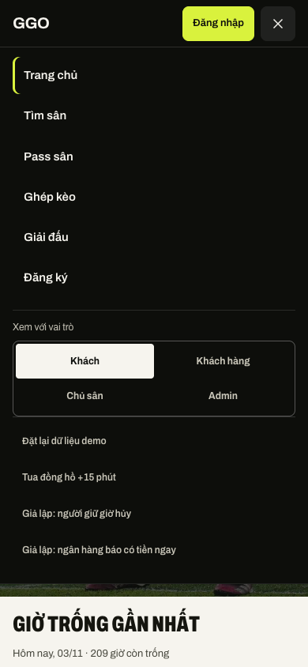

## 4.3. Trả lời câu hỏi kiểm tra kiến thức

**Câu 1. Thẻ `<header>` và `<nav>` có vai trò gì?**

- `<header>` đánh dấu phần đầu trang, nơi chứa logo, menu, nút đăng nhập.
- `<nav>` đánh dấu nhóm liên kết điều hướng chính.

Hai thẻ này không đổi giao diện, nhưng giúp trình duyệt, công cụ tìm kiếm và trình đọc màn hình hiểu đâu là phần đầu trang, đâu là menu. Người khiếm thị có thể nhảy thẳng tới menu. GGO có hai `<nav>` (menu máy tính và menu điện thoại), nên mỗi cái có `aria-label` riêng để phân biệt.

**Câu 2. Vì sao dùng Flexbox cho header có thể thuận tiện hơn so với định vị thủ công?**

Với Flexbox, chỉ cần `display: flex; align-items: center` là logo, menu, nút nằm cùng một hàng và canh giữa theo chiều dọc. `gap` tạo khoảng cách đều, còn `margin-left: auto` đẩy nhóm nút sang sát phải. Khi chữ menu dài hơn hay màn hình hẹp lại, các phần tử tự co giãn. Nếu định vị thủ công bằng `position: absolute` và tọa độ, mỗi lần đổi chữ hay đổi màn hình lại phải tính lại, rất dễ chồng lên nhau.

**Câu 3. Nếu menu hiển thị tốt trên máy tính nhưng bị chật trên điện thoại, nhóm sẽ điều chỉnh như thế nào?**

Dùng `@media` để đổi cách hiện menu theo độ rộng màn hình. GGO đang làm như vậy: dưới 900 px thì ẩn menu ngang (`.nav { display: none }`) và hiện nút ba gạch; bấm nút thì mở menu dọc toàn chiều ngang, mỗi mục cao 47 px cho dễ bấm. Menu đóng thì có thêm `visibility: hidden` để phím Tab không rơi vào liên kết đang ẩn.

# V. Trang danh sách sản phẩm

## 5.1. Xây dựng trang danh sách sân

- Trang `venues.html` hiển thị **40 sân** (dữ liệu mẫu `public/mock/venues.json`), nhiều hơn mức tối thiểu 8.
- Mỗi thẻ có cùng cấu trúc: ảnh, nhãn ưu đãi, tên sân, quận, loại sân, khoảng giá, các giờ còn trống. Bấm tên sân hoặc một ô giờ thì mở trang chi tiết.
- Lưới thẻ dùng CSS Grid:

```
.card-grid { display: grid; gap: var(--sp-4); grid-template-columns: 1fr; }
@media (min-width: 720px)  { .card-grid { grid-template-columns: repeat(2, 1fr); } }
@media (min-width: 1100px) { .card-grid { grid-template-columns: repeat(3, 1fr); } }
```

Ảnh trong thẻ không bị méo vì khung ảnh có tỉ lệ cố định, còn ảnh được cắt vừa khung:

```
.venue-card .media { aspect-ratio: 16 / 8; overflow: hidden; }
.venue-card .media img { width: 100%; height: 100%; object-fit: cover; }
```

Ảnh trang danh sách ở 3 khổ: Hình 7.4–7.6.

## 5.2. Trả lời câu hỏi kiểm tra kiến thức

**Câu 1. CSS Grid và Flexbox khác nhau như thế nào?**

- **Flexbox** bố trí theo **một chiều**: một hàng hoặc một cột. Hợp với thanh menu, hàng nút, hàng chip.
- **Grid** bố trí theo **hai chiều**: cả hàng và cột cùng lúc. Hợp với lưới thẻ sản phẩm, bố cục trang nhiều cột.

Ở GGO, header và hàng chip dùng Flexbox, còn lưới thẻ sân `.card-grid` dùng Grid.

**Câu 2. Nếu muốn hiển thị 4 sản phẩm mỗi hàng trên máy tính, nhóm cần điều chỉnh thuộc tính nào?**

Sửa `grid-template-columns` của `.card-grid` trong khổ máy tính, từ `repeat(3, 1fr)` thành `repeat(4, 1fr)`:

```
@media (min-width: 1100px) { .card-grid { grid-template-columns: repeat(4, 1fr); } }
```

Nên giữ 4 cột chỉ cho màn hình đủ rộng. Ở 1100 px, mỗi thẻ sẽ chỉ còn khoảng 250 px, nên có thể chuyển mốc lên 1280 px để tên sân và các giờ trống không bị chật.

**Câu 3. Nếu tên sản phẩm dài khiến các thẻ không đồng đều, nhóm có thể xử lý ra sao?**

- Lưới Grid tự kéo các thẻ cùng hàng cao bằng nhau. Thẻ sân còn dùng `display: grid; grid-template-rows: auto 1fr`, nên phần nội dung giãn ra lấp đầy thẻ.
- Có thể giới hạn tên trong 2 dòng bằng `display: -webkit-box; -webkit-line-clamp: 2; overflow: hidden`.
- Hoặc đặt `min-height` cho phần tên để mọi thẻ chừa chỗ như nhau.

Tên sân ở GGO khá dài (ví dụ "SÂN BANH MINI 20 CỘNG HÒA GARDENS") nên được cho xuống dòng tự nhiên, còn Grid giữ các thẻ cùng chiều cao.

# VI. Trang chi tiết sản phẩm và trang giới thiệu

## 6.1. Trang chi tiết sân

- Trang `venue.html` có:
  - ảnh sân, có khai báo `width`/`height` và `alt`;
  - tên sân, giá ("từ … / giờ" và giá từng ô giờ);
  - mô tả;
  - thuộc tính: tiện ích, loại sân 5 hoặc 7 người, giờ mở cửa, chính sách hủy, liên kết Google Maps.
- **Nút mua:** nút **Đặt sân** màu lime nằm ở thanh cố định cuối màn hình. Nút chỉ bật khi khách đã chọn một giờ trống, rồi mở hộp xác nhận. Trên bản dữ liệu mẫu, bấm nút chỉ tạo đơn giả, không thanh toán thật.
- **Quay lại danh sách:** breadcrumb "Trang chủ / Tìm sân / tên sân".

Ảnh trang chi tiết ở 3 khổ: Hình 7.7–7.9.

## 6.2. Trang giới thiệu

- Trang `about.html` dùng HTML semantic: `<header>`, `<main>`, các `<section>` có tiêu đề `<h2>`, ảnh trong `<figure>`/`<figcaption>`, thông tin liên hệ trong `<dl>`.
- Nội dung chia 5 phần:
  1. GGO làm gì;
  2. Dành cho ai (đội đá phủi và chủ sân mini);
  3. Điểm nổi bật (6 mục);
  4. Ảnh minh họa;
  5. Liên hệ.
- Hai ảnh minh họa hiển thị theo tỉ lệ 3:2 bằng `aspect-ratio: 3 / 2; object-fit: cover`, nên không méo.
- Bố cục dùng Grid và đổi số cột theo màn hình: khối "Điểm nổi bật" 3 → 2 → 1 cột, khối "Dành cho ai" 2 → 1 cột.

Ảnh trang giới thiệu ở 3 khổ: Hình 7.10–7.12.

## 6.3. Trả lời câu hỏi kiểm tra kiến thức

**Câu 1. Vì sao trang chi tiết sản phẩm cần bố cục khác trang danh sách sản phẩm?**

Hai trang phục vụ hai việc khác nhau:
- **Trang danh sách** giúp khách **so sánh nhanh** nhiều sân, nên mỗi thẻ chỉ có thông tin chính (ảnh, tên, giá, giờ trống) và xếp thành lưới.
- **Trang chi tiết** giúp khách **ra quyết định** cho một sân, nên cần ảnh lớn, mô tả, tiện ích, chính sách hủy, lưới giờ đầy đủ và một nút Đặt sân nổi bật. Nếu dùng chung bố cục lưới, thông tin sẽ bị chia nhỏ và khó đọc.

**Câu 2. Khi nào nên dùng Grid, khi nào nên dùng Flexbox?**

- **Dùng Grid** khi cần chia cả hàng lẫn cột, hoặc cần các ô thẳng hàng với nhau. Ví dụ: lưới thẻ sân, khối "Điểm nổi bật" 3 cột, bố cục hai cột chữ + ảnh ở trang giới thiệu.
- **Dùng Flexbox** khi chỉ cần xếp một hàng hay một cột và để phần tử tự co giãn theo nội dung. Ví dụ: header, hàng nút, hàng chip lọc, nhãn trên ảnh.

**Câu 3. Vì sao nội dung giới thiệu cần được chia thành các phần thay vì đặt trong một đoạn văn dài?**

Người đọc trên web thường lướt chứ không đọc từng chữ. Chia thành các phần có tiêu đề ("GGO làm gì", "Dành cho ai", "Điểm nổi bật") giúp khách tìm nhanh điều mình cần. Trên điện thoại, một đoạn văn dài rất mệt mắt. Mỗi phần dùng `<section>` có `<h2>` còn giúp trình đọc màn hình và công cụ tìm kiếm hiểu cấu trúc trang.

# VII. Responsive

## 7.1. Tiêu chí kiểm thử 3 kích thước

Nhóm đo bằng Playwright trên Chrome, chạy bản dữ liệu mẫu ở máy, cho 4 trang ở 3 khổ.

*Bảng 7.1. Tiêu chí và kết quả kiểm thử 3 kích thước*

| Tiêu chí của đề | Cách đo | Kết quả |
| --- | --- | --- |
| Không tràn ngang | So `scrollWidth` với độ rộng màn hình | Bằng nhau ở cả 12 trường hợp (4 trang × 3 khổ). Dải chữ chạy ở trang chủ nằm trong khung `overflow: hidden` (cố ý), không tạo thanh cuộn ngang |
| Ảnh không méo | So tỉ lệ hiển thị với tỉ lệ gốc của từng ảnh | 5 ảnh ở trang chủ, 40 ở danh sách, 1 ở chi tiết, 2 ở giới thiệu: đúng tỉ lệ hoặc dùng `object-fit: cover`; cả 48 ảnh đều có `alt`, `width`, `height` và tải được |
| Danh sách đổi số cột | Đếm số cột của `.card-grid` | 3 cột ở 1366, 2 cột ở 768, 1 cột ở 390 |
| Menu không chồng lấn | Kiểm từng cặp phần tử trên header | Header cao 60 px ở cả 3 khổ, không chồng lấn. 1366: menu ngang; 768 và 390: gọn vào nút menu |
| Banner không mất nội dung | Kiểm ảnh nền, tiêu đề, nút nằm trong khung | Đủ ở cả 3 khổ |
| Nút dễ bấm trên điện thoại | Đo chiều cao mọi nút, chip, ô chọn ở 390 px | Sau khi sửa, tất cả cao tối thiểu 44 px (xem Bảng 7.2) |

*Nguồn: Nhóm tác giả*

## 7.2. Ảnh chụp 4 trang ở 3 kích thước

Ảnh chụp toàn trang dài được cắt thành nhiều cột đặt cạnh nhau, đọc từ trái sang phải. Ảnh chụp bản dữ liệu mẫu nên có thêm nút "vai trò demo" ở góc dưới; bản thật không có nút này.

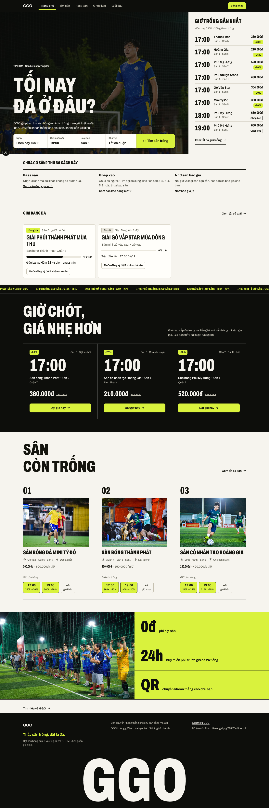

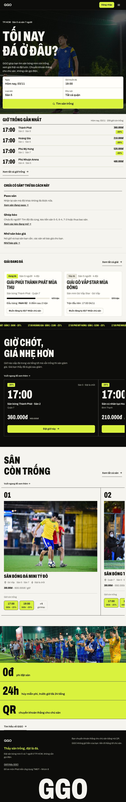

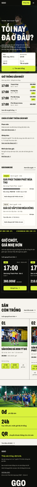

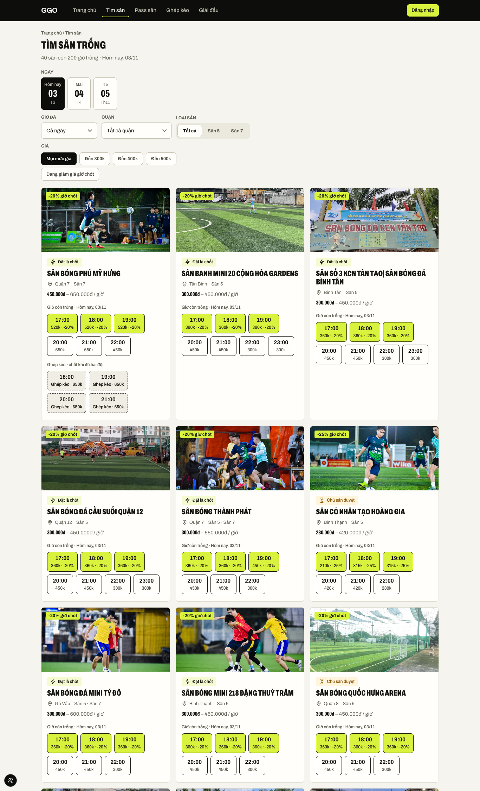

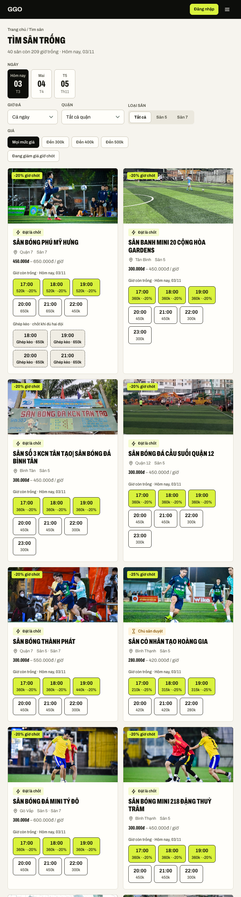

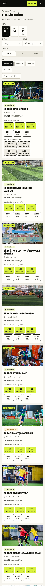

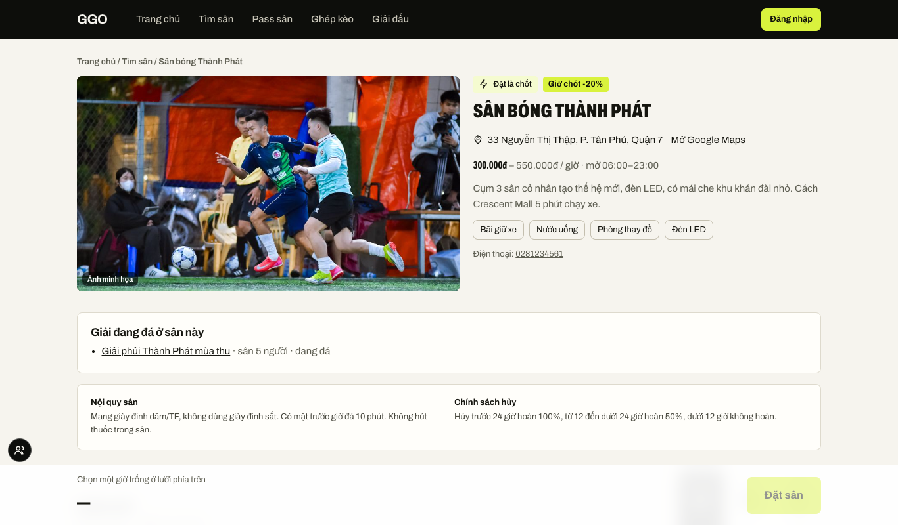

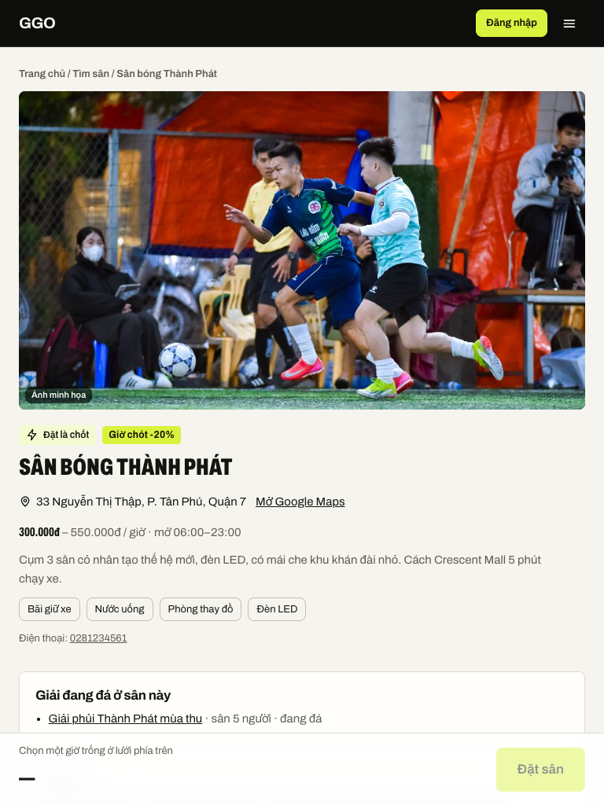

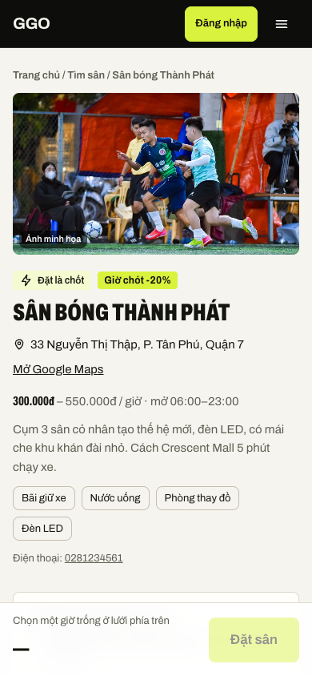

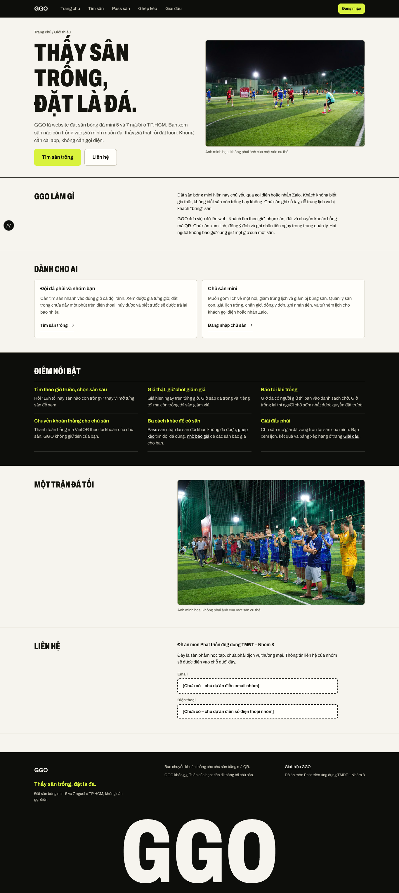

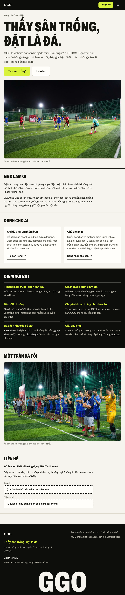

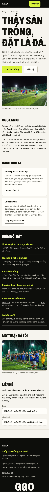

## 7.3. Lỗi phát hiện và cách khắc phục

*Bảng 7.2. Lỗi và cách khắc phục*

| # | Lỗi | Trang / khổ | Cách xử lý | Kết quả trước → sau |
| --- | --- | --- | --- | --- |
| 1 | Một số nút **nhỏ hơn 44 px**, khó bấm trên điện thoại | 390 px: nút Đăng nhập, chip lọc, nút "Báo tôi khi trống", nút mở menu | Thêm khối `@media (max-width: 639.98px)` đặt `min-height: 44px` cho nút nhỏ, chip, nút chọn; nút menu 44×44 px | Đăng nhập 34 → 44 px; chip 36 → 44 px; "Báo tôi khi trống" 33 → 44 px; nút menu 40 → 44 px; ô chọn ở trang chủ 26 → 48 px. Không còn nút nào dưới 44 px |
| 2 | Tên sân (liên kết xem chi tiết) **không có hiệu ứng hover riêng** | Danh sách sân, mọi khổ | Gạch chân 2 px trong suốt, hover thì đổi sang màu chữ, có `transition` | Gạch chân hiện khi hover, kích thước tên giữ nguyên, không xê dịch |
| 3 | **Chưa có trang giới thiệu** và chưa có liên kết tới nó | Trang chủ | Thêm `about.html`, liên kết ở cuối trang chủ và ở footer mọi trang | Trang trả 200, không tràn ngang ở 3 khổ |
| 4 | **Vòng focus gần như không thấy trên nền tối**: viền màu `#15150f` trên header `#0d0e0b` | Header, menu điện thoại, mọi khổ | Vòng focus dùng biến `--focus`: màu chữ trên nền sáng, lime trên nền tối | Độ tương phản 1,06:1 → 15,41:1 |
| 5 | Menu điện thoại đã đóng **vẫn nhận phím Tab** | 768 / 390 px | Thêm `visibility: hidden` khi menu đóng | Tab không còn rơi vào liên kết ẩn |
| 6 | Mục "Giờ chót" và "Sân còn trống" ở trang chủ là **băng cuộn ngang** | Trang chủ, 768 / 390 px | Giữ nguyên vì cố ý theo thiết kế, có chữ "Vuốt ngang để xem thêm" | Không tạo cuộn ngang cho cả trang |

*Nguồn: Nhóm tác giả*

## 7.4. Trả lời câu hỏi kiểm tra kiến thức

**Câu 1. `@media` trong CSS có vai trò gì?**

`@media` cho phép áp quy tắc CSS chỉ khi màn hình thỏa điều kiện, thường là độ rộng. Ví dụ, `@media (min-width: 720px) { .card-grid { grid-template-columns: repeat(2, 1fr); } }` nghĩa là chỉ khi màn hình rộng từ 720 px thì lưới sân mới chia 2 cột. Nhờ đó, cùng một trang HTML hiển thị khác nhau trên máy tính, máy tính bảng và điện thoại. GGO viết CSS cho điện thoại trước, rồi dùng `min-width` để thêm cột khi màn hình rộng ra.

**Câu 2. Nếu trang danh sách bị tràn ngang trên điện thoại, nhóm sẽ kiểm tra những thành phần nào?**

Kiểm theo thứ tự:
1. Phần tử có chiều rộng cố định lớn hơn 390 px (`width: 500px`, `min-width`).
2. Ảnh thiếu `max-width: 100%`.
3. Lưới còn nhiều cột ở màn hình nhỏ.
4. Chữ dài không xuống dòng (đường link, mã đơn).
5. Hàng chip hoặc nút không cho xuống dòng (`flex-wrap`).
6. Phần tử dùng `margin` âm hoặc `position: absolute` vượt mép.

**Câu 3. Vì sao cần kiểm thử trên nhiều kích thước thay vì chỉ thu nhỏ cửa sổ trình duyệt một cách ngẫu nhiên?**

- Kéo cửa sổ ngẫu nhiên thì không biết đã kiểm đúng khổ của thiết bị thật chưa. Lỗi thường xảy ra ngay tại các mốc đổi bố cục (720, 900, 1100 px), và chỉ thu nhỏ lung tung dễ bỏ sót.
- Kiểm ở các độ rộng cố định (1366, 768, 390 px) thì kết quả lặp lại được, so sánh được trước và sau khi sửa, và chụp ảnh làm minh chứng được.
- DevTools còn giả lập được màn hình cảm ứng và mật độ điểm ảnh của điện thoại, điều mà thu nhỏ cửa sổ không làm được.

# VIII. Hiệu ứng hover/focus

## 8.1. Hover và focus trong mã nguồn

- **Focus bàn phím chung:** `:focus-visible { outline: 2px solid var(--focus); outline-offset: 2px; }`. Biến `--focus` là màu chữ trên nền sáng và lime trên nền tối. Dùng `outline` nên không làm xê dịch bố cục.
- **Liên kết menu:** `.nav a:hover` đổi màu chữ, `transition: color 0.18s`.
- **Nút:** `.btn:hover`, `.btn-lime:hover` đổi nền và viền, có `transition`.
- **Thẻ sân:** `.card-hover:hover` đổi màu viền. Tên sân trong thẻ hiện gạch chân khi hover.
- Người dùng bật chế độ giảm chuyển động trong máy (`prefers-reduced-motion`) thì các hiệu ứng được tắt.

Mỗi ảnh dưới đây đặt hai trạng thái cạnh nhau: "Bình thường" và "Hover" hoặc "Focus (Tab)". Vị trí và kích thước phần tử được đo trước và sau: không phần tử nào bị xê dịch.

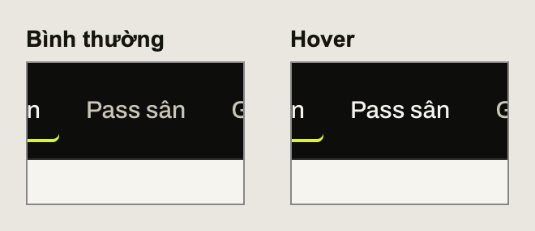

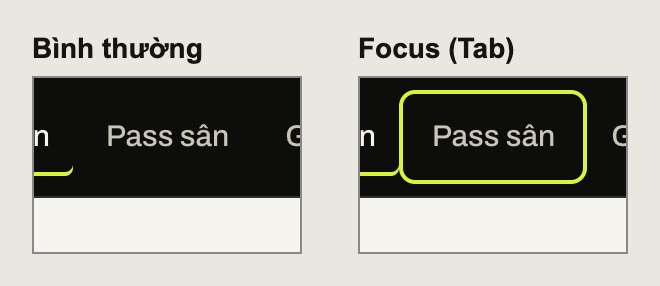

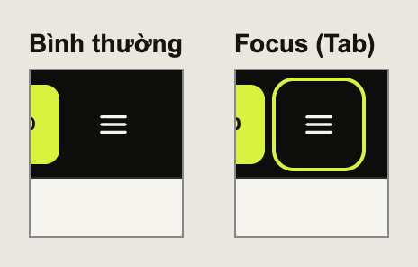

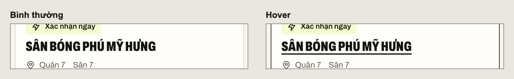

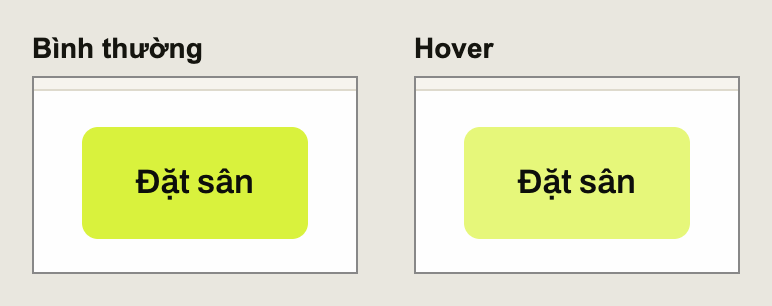

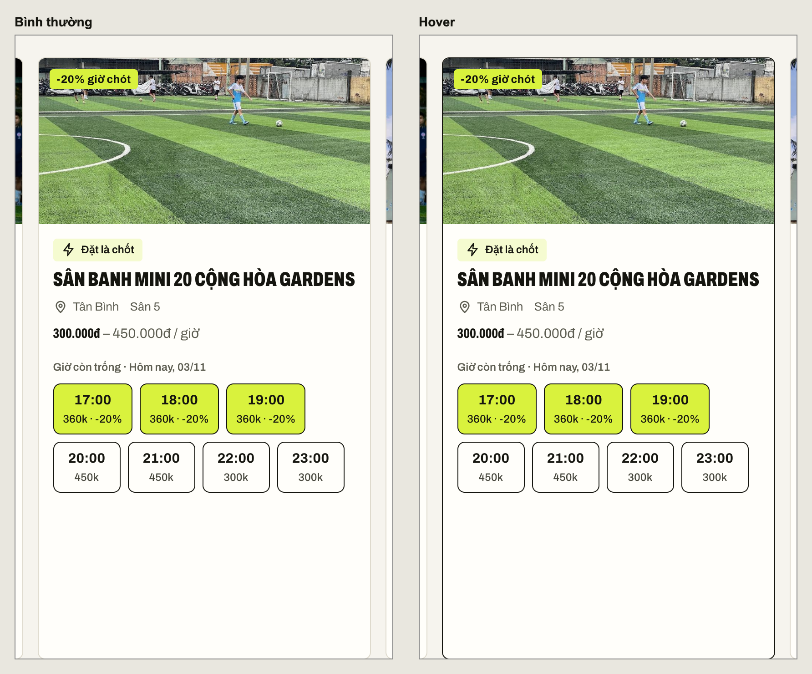

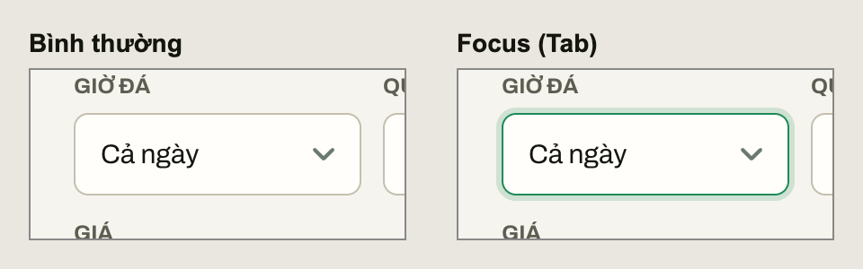

## 8.2. Trả lời câu hỏi kiểm tra kiến thức

**Câu 1. `:hover` và `:focus` khác nhau như thế nào?**

- `:hover` xảy ra khi **di chuột** lên phần tử. Trên điện thoại gần như không có hover thật.
- `:focus` xảy ra khi phần tử **đang được chọn để nhận thao tác**: bấm Tab tới, bấm vào ô nhập, hoặc chạm vào. Người dùng bàn phím và người dùng trình đọc màn hình dựa vào focus để biết mình đang ở đâu.

`:focus-visible` là dạng focus chỉ hiện khi dùng bàn phím, nên bấm chuột vào nút không làm hiện vòng viền thừa. GGO dùng `:focus-visible` cho vòng focus chung.

**Câu 2. Vì sao không nên loại bỏ hoàn toàn đường viền focus mà không có phương án thay thế?**

Người dùng bàn phím sẽ không biết mình đang đứng ở liên kết hay nút nào, bấm Enter mà không biết sẽ mở cái gì. Như vậy web không dùng được với bàn phím, vi phạm nguyên tắc dễ tiếp cận. Nếu thấy viền mặc định xấu, hãy thay bằng kiểu khác đủ rõ chứ không xóa. GGO từng gặp trường hợp viền có nhưng gần như vô hình: màu đen trên header đen, tương phản 1,06:1. Nhóm đã sửa thành lime trên nền tối (15,41:1).

**Câu 3. Nếu hiệu ứng hover làm thẻ sản phẩm che mất thẻ bên cạnh, nhóm sẽ xử lý ra sao?**

- Không dùng hiệu ứng làm thẻ to ra hay lấn chỗ, ví dụ `transform: scale(1.1)` lớn hoặc đổi `width`/`padding` khi hover.
- Thay bằng hiệu ứng không đổi kích thước: đổi màu viền, đổi bóng đổ, gạch chân tiêu đề.
- Nếu vẫn muốn phóng to, giữ mức nhỏ (`scale(1.02)`), tăng `gap` giữa các thẻ và đặt `z-index` cho thẻ đang hover.

GGO chọn cách đổi màu viền nên kích thước thẻ trước và sau hover giữ nguyên (661×367 px).

# IX. Tích hợp, kiểm thử và hoàn thiện GitHub

## 9.1. Bảng kiểm thử website GGO

Ngoài kiểm bằng mắt, nhóm có bộ kiểm thử tự động trên trình duyệt (thư mục `e2e/`, dùng Playwright). Bộ này tự mở trang, bấm nút, kiểm kết quả ở khổ 390 và 1280 px. Lần chạy cuối: **30/30 luồng đạt, 0 lỗi**.

*Bảng 9.1. Bảng kiểm thử theo 7 nhóm tiêu chí của đề*

| ID | Nhóm | Thao tác | Kết quả mong đợi | Kết quả |
| --- | --- | --- | --- | --- |
| TC01 | Liên kết | Bấm từng mục menu: Trang chủ, Tìm sân | Mở đúng `index.html`, `venues.html` | Đạt |
| TC02 | Liên kết | Ở danh sách, bấm tên một sân | Mở `venue.html` đúng sân | Đạt |
| TC03 | Liên kết | Ở chi tiết, bấm "Tìm sân" trên breadcrumb | Về danh sách sân | Đạt |
| TC04 | Liên kết | Bấm "Tìm hiểu về GGO →" và "Giới thiệu GGO" ở footer | Mở `about.html` | Đạt |
| TC05 | Liên kết | Kiểm mọi liên kết nội bộ trên 4 trang | Không có liên kết chết | Đạt: trang chủ 25, danh sách 257, chi tiết 9, giới thiệu 10 liên kết đều trả 200 |
| TC06 | CSS chung | Kiểm thẻ `<link>` của 4 trang | Cùng dùng `/css/app.css` | Đạt |
| TC07 | Hình ảnh | Mở 4 trang, xem Console | Không có lỗi tải ảnh | Đạt: Console 0 lỗi |
| TC08 | Hình ảnh | Kiểm `alt`, `width`, `height` | Ảnh có đủ thuộc tính | Đạt |
| TC09 | Đủ 8 sản phẩm | Đếm thẻ sân ở danh sách | ≥ 8 | Đạt: 40 sân |
| TC10 | Bố cục | Mở 4 trang ở 3 khổ | Không vỡ bố cục, không chồng lấn | Đạt |
| TC11 | Bố cục | Đo dịch chuyển bố cục khi tải trang chủ | Dưới 0,1 | Đạt: 0 ở 390 px, 0,0072 ở 1280 px |
| TC12 | Responsive | Đo tràn ngang 4 trang × 3 khổ | Không tràn | Đạt cả 12 trường hợp |
| TC13 | Responsive | Đếm cột danh sách | 3 / 2 / 1 cột | Đạt |
| TC14 | Responsive | Đo vùng bấm ở 390 px | ≥ 44 px | Đạt sau khi sửa (Bảng 7.2) |
| TC15 | Hover/focus | Di chuột lên menu, nút, thẻ, tên sân | Có thay đổi rõ, không xê dịch | Đạt (Hình 8.1–8.6) |
| TC16 | Hover/focus | Bấm Tab qua toàn trang | Thấy rõ vòng focus trên mọi nền | Đạt sau khi sửa: tương phản ≥ 14,59:1 |

*Nguồn: Nhóm tác giả*

## 9.2. Đánh giá mã nguồn bằng AI

Nhóm làm web với sự hỗ trợ **lớn** của AI (viết mã, viết kiểm thử, sửa lỗi, soạn tài liệu); các thành viên điều hướng, kiểm tra và quyết định. Dưới đây là 2 vấn đề có thật mà AI đề xuất, cùng cách nhóm kiểm và quyết định.

*Bảng 9.2. Kết quả đánh giá hai vấn đề do AI đề xuất*

| Nội dung | Vấn đề 1 – Trang nhảy khi tải | Vấn đề 2 – Chờ cứng trong kiểm thử |
| --- | --- | --- |
| File | `public/css/app.css`, `public/index.html` | `e2e/f-stake.mjs` |
| Vấn đề | Header dựng xong sau khi trang tải, đẩy nội dung xuống 60 px | Đề xuất chờ cố định bằng `waitForTimeout(...)` rồi mới đọc kết quả |
| Mức độ | Cao (người dùng thấy rõ) | Trung bình (kiểm thử chập chờn) |
| Đề xuất AI | Giữ sẵn chỗ cho header đúng chiều cao, nền và viền như header thật | Chờ một khoảng thời gian cố định |
| Kiểm trên trình duyệt | Đo dịch chuyển bố cục bằng `PerformanceObserver` trong Chrome | Chạy kiểm thử trên Chrome ở 390 và 1280 px |
| Quyết định | **Áp dụng** | **Loại bỏ** |
| Kết quả | Dịch chuyển bố cục lúc tải còn 0 ở 390 px và 0,0072 ở 1280 px (ngưỡng tốt là 0,1) | Đổi sang chờ tín hiệu thật (thông báo "Đã ghi nhận…" hiện ra), kiểm thử chạy ổn định |

*Nguồn: Nhóm tác giả*

**Vấn đề 1 – áp dụng.**
- **Tình huống:** header được JavaScript dựng sau khi trang tải. Trong lúc chờ, chỗ của header trống, nên khi header hiện ra thì toàn bộ nội dung bị đẩy xuống 60 px. Người dùng thấy trang "giật" một cái.
- **Đề xuất của AI:** đặt sẵn một khung giữ chỗ:

```
#app-header { height: var(--header-h); background: var(--pitch-950); border-bottom: 1px solid rgb(246 244 238 / 0.14); box-sizing: border-box; }
```

- **Cách kiểm:** nhóm đo dịch chuyển bố cục ngay từ lần vẽ đầu tiên. Trước đó bài kiểm phải ghi chú bỏ qua 2 giây đầu vì "có lệch 60 px", tức là lỗi có thật.
- **Kết quả:** sau khi sửa, chỉ số gần như bằng 0.

**Vấn đề 2 – loại bỏ.**
- **Đề xuất của AI:** sau khi bấm nút "Đã nhận" thì chờ cứng một khoảng thời gian rồi đọc kết quả.
- **Lý do loại bỏ:** máy nhanh thì chờ thừa, máy chậm thì đọc quá sớm. Thêm nữa, nhãn nút "Đã nhận…" có sẵn trước khi bấm, nên không dùng chữ trên nút để biết thao tác đã xong được.
- **Cách làm thay:** chờ thông báo thành công hiện ra.
- **Bài học:** đề xuất của AI có thể chạy được trên máy mình nhưng vẫn sai về nguyên tắc; phải hiểu vì sao nó chạy.

## 9.3. GitHub và README

- **Link repository:** **[ĐIỀN]**
- **Web xem trực tiếp:** https://ggo-datsan.pages.dev (bản dữ liệu mẫu, không cần backend).
- `README.md` có mục **"Phạm vi Buổi 2 (HTML & CSS)"**:
  - giới thiệu và danh sách trang;
  - công nghệ;
  - cách mở web (`npm run prototype` rồi mở http://localhost:4100);
  - cách kiểm responsive (DevTools ở 1366 / 768 / 390 px);
  - hạn chế hiện tại: dữ liệu mẫu lưu trong trình duyệt, cần bật JavaScript, phần backend là mở rộng ngoài phạm vi Buổi 2.
- Ảnh chụp minh chứng nằm trong `docs/buoi2/screens/`.

# X. Câu hỏi kiến thức

## 10.1. Giải thích mã nguồn

**Đoạn HTML:** thẻ sân trong trang danh sách (rút gọn từ `public/js/venues.js`):

```
<article class="card card-hover venue-card">
  <div class="media">
    
    <div class="tags"><span class="tag-sale">-20% giờ chót</span></div>
  </div>
  <div class="body">
    <a class="title" href="/venue.html?id=…">Tên sân</a>
    <div class="meta"><span>Tân Bình</span><span>Sân 5</span></div>
    <div><span class="price">300.000đ</span> <span class="muted">– 450.000đ / giờ</span></div>
    <div class="slot-pills"><a class="slot-pill" href="…">18:00 · 360k</a> …</div>
  </div>
</article>
```

- `<article>`: một thẻ sân là một khối nội dung trọn vẹn, đứng riêng vẫn có nghĩa.
- `<div class="media">`: khung chứa ảnh và nhãn ưu đãi; `<div class="body">`: phần chữ của thẻ.
- `<a class="title">`: tên sân là liên kết sang trang chi tiết; mỗi ô giờ (`.slot-pill`) cũng là liên kết, mở thẳng trang chi tiết ở đúng giờ đó.
- `` có `alt` (tên sân, hoặc "Ảnh minh họa…" nếu không phải ảnh thật của sân) để mô tả ảnh khi ảnh lỗi hoặc cho trình đọc màn hình; `width`/`height` để trình duyệt giữ chỗ trước khi ảnh tải xong; `loading="lazy"` để ảnh ở dưới chỉ tải khi cuộn tới.

**Đoạn CSS:**

```
.venue-card { display: grid; grid-template-rows: auto 1fr; overflow: hidden; }
.venue-card .media { aspect-ratio: 16 / 8; overflow: hidden; }
.venue-card .media img { width: 100%; height: 100%; object-fit: cover; }
```

- `display: grid; grid-template-rows: auto 1fr`: chia thẻ thành 2 hàng. Hàng ảnh cao theo nội dung, hàng chữ chiếm hết phần còn lại, nên các thẻ cùng hàng cao bằng nhau.
- `aspect-ratio: 16 / 8`: khung ảnh luôn rộng gấp đôi chiều cao, mọi thẻ có ảnh cùng cỡ dù ảnh gốc khác tỉ lệ.
- `object-fit: cover`: ảnh lấp đầy khung, phần thừa bị cắt bớt, không bị kéo giãn.
- `overflow: hidden`: cắt phần ảnh vượt khung và giữ góc bo tròn của thẻ.

**Ảnh hưởng tới giao diện:** lưới thẻ đều nhau, ảnh không méo, bố cục không nhảy khi ảnh tải chậm.

## 10.2. Dự đoán kết quả khi đổi `repeat(4, 1fr)` thành `repeat(2, 1fr)`

```
.product-list { display: grid; grid-template-columns: repeat(4, 1fr); gap: 16px; }
```

Đổi `repeat(4, 1fr)` thành `repeat(2, 1fr)` thì:
- lưới từ **4 cột** còn **2 cột**;
- mỗi thẻ rộng gần **gấp đôi**, vì `1fr` là một phần bằng nhau của chiều rộng còn lại sau khi trừ khoảng cách. Với 2 cột thì chỉ trừ 1 khoảng 16 px thay vì 3;
- số hàng tăng gấp đôi: 8 sản phẩm từ 2 hàng thành 4 hàng, nên trang dài hơn;
- ảnh trong thẻ to hơn; nếu ảnh có tỉ lệ cố định thì thẻ cũng cao hơn;
- `gap: 16px` giữ nguyên.

Lý do: `repeat(n, 1fr)` quyết định số cột, còn các thẻ tự xếp lần lượt vào ô trống, hết hàng thì xuống hàng mới. Ở GGO, chính thuộc tính này đổi theo `@media`: 1 cột trên điện thoại, 2 cột từ 720 px, 3 cột từ 1100 px.

## 10.3. Phát hiện lỗi

```
.product-image { width: 100%; height: 250px; }
```

- **Vì sao ảnh bị kéo giãn:** chiều rộng theo khung, chiều cao cố định 250 px, nên tỉ lệ khung khác tỉ lệ ảnh. Mặc định `object-fit: fill` sẽ ép ảnh vừa khung, làm ảnh bị bóp hoặc kéo.
- **Cách sửa:**

```
.product-image { width: 100%; height: 250px; object-fit: cover; object-position: center; display: block; }
```

- **Giải thích thuộc tính thêm vào:**
  - `object-fit: cover`: giữ đúng tỉ lệ ảnh, phóng ảnh cho phủ kín khung rồi cắt phần thừa;
  - `object-position: center`: chọn phần giữ lại khi cắt (giữa ảnh); đổi thành `top` nếu phần quan trọng ở phía trên;
  - `display: block`: bỏ khoảng hở nhỏ dưới ảnh do ảnh mặc định nằm trên dòng chữ.
- **Cách khác:** bỏ `height: 250px`, dùng `aspect-ratio: 4 / 3` cho chiều cao tự theo chiều rộng. GGO dùng cách này: `aspect-ratio` cho khung, `object-fit: cover` cho ảnh.
- Nếu ảnh phải hiện đủ, không được cắt (ví dụ logo), dùng `object-fit: contain`. Ảnh sẽ nằm gọn trong khung và có thể có viền trống.

## 10.4. Grid hay Flexbox? Vì sao?

**Dùng Grid ở đâu:**
- lưới thẻ sân `.card-grid` (1/2/3 cột);
- bên trong thẻ sân (hàng ảnh và hàng chữ);
- khối "Điểm nổi bật" và "Dành cho ai" ở trang giới thiệu;
- bố cục hai cột chữ + ảnh.

Lý do: các phần này cần chia cột rõ ràng, thẳng hàng cả ngang lẫn dọc, và đổi số cột theo màn hình chỉ bằng một thuộc tính `grid-template-columns`.

**Dùng Flexbox ở đâu:**
- header (logo, menu, nút xếp một hàng, canh giữa theo chiều dọc);
- hàng nút, hàng chip lọc;
- nhãn nằm trên ảnh sân.

Lý do: chỉ cần xếp một hàng, kích thước mỗi phần tử theo nội dung, `margin-left: auto` đẩy nhóm nút sang phải rất gọn.

**Tình huống phương án kia phù hợp hơn:**
- Hàng chip lọc có số lượng và độ dài chữ khác nhau ("Hôm nay", "Quận Tân Bình", "Sân 7") hợp với Flexbox `flex-wrap: wrap` hơn Grid, vì mỗi chip rộng theo chữ của nó và tự xuống dòng khi hết chỗ. Dùng Grid thì chip ngắn cũng bị kéo bằng ô.
- Ngược lại, nếu dùng Flexbox cho lưới thẻ sân, hàng cuối chỉ có 1–2 thẻ sẽ bị kéo giãn hoặc lệch so với các hàng trên. Grid giữ mọi ô cùng chiều rộng.

## 10.5. Kiểm tra responsive: web tràn ngang ở 390 px

**Công cụ:** Chrome DevTools, chế độ thiết bị (Ctrl/Cmd + Shift + M), đặt độ rộng 390 px.

**Các bước:**
1. Xác nhận có tràn: gõ vào Console `document.documentElement.scrollWidth > innerWidth`. Nếu `true` là có tràn.
2. Tìm phần tử thủ phạm: chạy đoạn lệnh liệt kê phần tử có `getBoundingClientRect().right` lớn hơn 390, hoặc thêm tạm `* { outline: 1px solid red }` để nhìn khung từng phần tử.
3. Kiểm trước các phần tử hay gây lỗi:
   - phần tử có `width` hoặc `min-width` cố định lớn;
   - ảnh thiếu `max-width: 100%`;
   - lưới vẫn nhiều cột ở màn hình nhỏ;
   - hàng flex không có `flex-wrap`;
   - chữ dài không xuống dòng;
   - `margin` âm.
4. Sửa trong tab Elements để thử ngay, đúng rồi mới chép vào file CSS. Kiểm lại ở cả 768 và 1366 để chắc không làm hỏng khổ khác.

Ví dụ thực tế ở GGO: khi đo, phần tử duy nhất vượt mép phải là dải chữ chạy `.ticker-track` ở trang chủ. Nhưng nó nằm trong khung `overflow: hidden` nên không tạo thanh cuộn ngang. Đây là cố ý, không phải lỗi.

## 10.6. Đánh giá nội dung AI tạo ra

- **Đề xuất của AI:** khi viết CSS, AI dùng một kiểu vòng focus cho toàn web: `:focus-visible { outline: 2px solid var(--text); }`, màu `#15150f`.
- **Cách kiểm:** bấm Tab qua từng trang ở 390 và 1366 px, chụp ảnh mỗi lần Tab và đo độ tương phản giữa vòng focus với nền ngay quanh nó.
- **Kết quả thực tế:** trên nền sáng thì rõ. Nhưng trên header tối `#0d0e0b`, độ tương phản chỉ **1,06:1**, gần như vô hình (mức tối thiểu nên đạt là 3:1). Khi kiểm, nhóm còn phát hiện menu điện thoại đã đóng vẫn nhận phím Tab.
- **Cách điều chỉnh:** đổi màu vòng focus theo nền bằng biến `--focus` (lime `#d9f23d` trên nền tối), thêm `visibility: hidden` cho menu đóng. Đo lại được **15,41:1**.
- **Rút ra:** đề xuất của AI đúng cú pháp và trông hợp lý khi đọc mã, nhưng chỉ kiểm trên trình duyệt, đúng thao tác và đúng nền màu mới thấy lỗi. Nhóm không chấp nhận một đề xuất chỉ vì nó "chạy được"; phải có số đo trước và sau.

# XI. Phụ lục

## 1. Link GitHub và web

- GitHub: **[ĐIỀN]**
- Web: https://ggo-datsan.pages.dev

## 2. Các yêu cầu chính nhóm đã giao cho AI

Nhóm làm việc với AI agent qua nhiều lượt trao đổi, nên không có một bộ prompt cố định như mẫu của đề. Dưới đây là các yêu cầu chính, tóm tắt theo thứ tự thực hiện; mỗi yêu cầu ứng với một hoặc vài commit trong repo.

1. Dựng nền giao diện từ báo cáo Buổi 1 và PRD: font, bảng màu, bộ nút và thẻ dùng chung, header theo vai trò người dùng.
2. Làm trang chủ theo hướng "tìm theo giờ trước, chọn sân sau": banner ảnh thật, ô tìm sân, khối giờ trống gần nhất.
3. Làm danh sách sân và chi tiết sân với lưới giờ, giá từng giờ, nút Đặt sân; gọn bộ lọc trên điện thoại.
4. Viết lại chữ trên web cho dễ hiểu với người dùng phổ thông; thêm tiêu đề và mô tả cho từng trang.
5. Rà toàn bộ 4 trang theo yêu cầu Buổi 2 (tương tự Prompt 9A, 9B của đề): kiểm liên kết, tràn ngang, ảnh méo, số cột, vùng bấm, hover/focus ở 1366 / 768 / 390 px, báo lỗi kèm số đo. Không khẳng định lỗi khi chưa có bằng chứng.
6. Sửa các lỗi tìm được bằng CSS (vùng bấm 44 px, hover tên sân, vòng focus trên nền tối) và đo lại.
7. Làm trang giới thiệu theo nội dung PRD, không bịa thông tin liên hệ.
8. Soạn README mục "Phạm vi Buổi 2" (tương tự Prompt 9C): không khẳng định backend, CSDL hay thanh toán thuộc Buổi 2.
