# Hồ sơ nộp bài tập nhóm Buổi 2 – HTML & CSS (GGO, Nhóm 8)

Tài liệu này đi theo đúng thứ tự 12 mục của bảng "Sản phẩm cuối cùng cần nộp" trong `docs/buoi2/de-bai.md`.
Quy ước ánh xạ sang GGO: "sản phẩm" là **sân bóng**, trang danh sách là `venues.html`, trang chi tiết là `venue.html`, "nút mua" là nút **Đặt sân**.

Ký hiệu: **[ĐIỀN]** = chủ dự án hoặc thành viên tự điền. Ảnh nằm trong `docs/buoi2/screens/`.

## Phạm vi công nghệ (nói rõ trước để khỏi hiểu nhầm)

Đề Buổi 2 chỉ yêu cầu HTML5/CSS3, chưa yêu cầu JavaScript, backend, CSDL, đăng nhập thật, giỏ hàng, thanh toán. Sản phẩm của nhóm **nhiều hơn** phạm vi đó:

| Phần | Có trong repo | Thuộc phạm vi đề Buổi 2? |
| --- | --- | --- |
| Trang HTML: `public/*.html` | Có (nhiều trang, trong đó 4 trang cần cho đề: `index.html`, `venues.html`, `venue.html` và `about.html`) | Có |
| CSS: `public/css/app.css` (dùng chung), `owner.css`, `admin.css` | Có | Có |
| Grid, Flexbox, `@media`, `:hover`, `:focus-visible`, `transition` | Có trong `public/css/app.css` | Có |
| JavaScript (ES modules, không framework) trong `public/js/` | Có. Header, footer, danh sách sân và lưới giờ **do JS dựng** từ dữ liệu, không phải HTML tĩnh | Không (đề chưa yêu cầu) |
| Dữ liệu giả `public/mock/*.json` + `public/js/api-mock.js` | Có. Bản triển khai trên Cloudflare Pages chạy bằng dữ liệu giả này, **không cần backend** (`public/js/mode.js`: `SERVED_BY_API = false`) | Không |
| Backend Express + MySQL trong `src/`, `db/`, `tests/` | Có, chạy riêng bằng `npm start` | Không, vượt phạm vi |

Vì vậy **không viết là "chỉ dùng HTML/CSS"**. Phần HTML/CSS là các trang `public/*.html` và `public/css/`; các trang đó cần JS để hiện danh sách sân.

---

## 1. GitHub repository

- **Hiện trạng:** repo này chưa có remote (`git remote -v` trả về rỗng tại thời điểm viết). Chưa tạo repo và chưa push.
- Đề yêu cầu "tiếp tục repository đã tạo ở Buổi 1".
- Link repo Buổi 1: **[ĐIỀN]**
- Việc cần làm sau khi có link: thêm remote, đẩy mã, kiểm giảng viên mở được repo (chế độ public hoặc mời tài khoản giảng viên).
- Lịch sử commit hiện có: `git log --oneline` (36 commit, từ `294a576` "Bản nháp ban đầu" đến `7dea1e7`).

## 2. Trang chủ

- **File:** `public/index.html` + `public/css/app.css`, header/footer dựng bởi `public/js/ui/shell.js`, nội dung bởi `public/js/index-page.js`.
- **Logo:** Chữ GGO viết bằng Archivo hẹp, đậm 850, đã chuyển thành nét (ảnh SVG `public/img/logo-ggo-dark.svg` và `logo-ggo-light.svg`, không phụ thuộc font); lòng chữ O tô lime `#d9f23d`. Header và footer chỉ dùng chữ GGO này. Ô lime có chữ G (`public/img/favicon.svg`, kèm PNG 16/32 và `apple-touch-icon.png`) dùng làm favicon; ảnh chia sẻ của các trang tĩnh là `public/img/og-ggo.png`.
- **Header:** logo "GGO" (`.brand`, ảnh SVG), menu `<nav class="nav">` với Trang chủ, Tìm sân và mục **Thêm** (Pass sân, Ghép kèo, Giải đấu, Nhờ báo giá), nút Đăng nhập (`shell.js`, hằng `NAV`).
- **Footer:** `footer.site-footer` dựng bởi `shell.js`: logo GGO, khẩu hiệu "Thấy sân trống, đặt là đá." (`.footer-slogan`), một dòng mô tả, liên kết "Giới thiệu GGO" và chữ GGO cỡ lớn ở cuối (`.footer-wordmark`, là ảnh SVG `logo-ggo-dark.svg`, không phải chữ vẽ bằng CSS).
- **Banner:** `section.match-hero` có ảnh (`hero-1920.jpg`, ảnh dọc riêng cho màn nhỏ bằng `<picture>`), tiêu đề `h1` "Đặt sân bóng mini", lời dẫn, form tìm sân (ngày, giờ, loại sân, khu vực; lời kêu gọi hành động) và cột "Tối nay còn trống" với liên kết "Xem thêm".
- **Sân nổi bật:** băng thẻ "Sân còn trống" (`#venue-list`) kèm giờ trống bấm được, và cột "Tối nay còn trống" (`#tonight-rows`).
- **Liên kết tới trang danh sách:** form `action="/venues.html"` và liên kết "Xem tất cả sân".
- **Liên kết tới trang giới thiệu:** có, liên kết "Tìm hiểu về GGO →" ở cuối trang chủ và liên kết "Giới thiệu GGO" ở footer (xem mục 5).

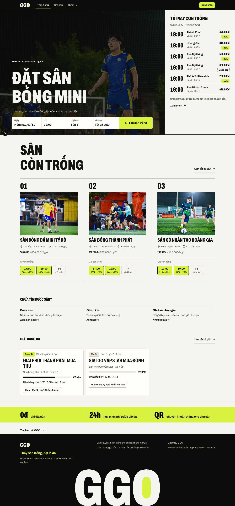

## 3. Trang danh sách sản phẩm (sân)

- **File:** `public/venues.html`, thẻ sân dựng bởi `public/js/venues.js` (hàm tạo `<article class="card card-hover venue-card">`).
- **Số lượng:** dữ liệu mẫu có **40 sân** (`public/mock/venues.json`), nhiều hơn mức tối thiểu 8. Số sân hiện ra thực tế phụ thuộc bộ lọc ngày/giờ/quận đang chọn.
- **Mỗi thẻ có:** ảnh, tên, giá, giờ trống; bấm vào mở trang chi tiết.
- **Bố cục:** `.card-grid` dùng CSS Grid, 1 cột (dưới 720 px), 2 cột (từ 720 px), 3 cột (từ 1100 px) (`public/css/app.css`, quanh dòng 2480).
- **Danh mục:** có chip lọc ngày, giờ, quận, loại sân (không bắt buộc theo đề).

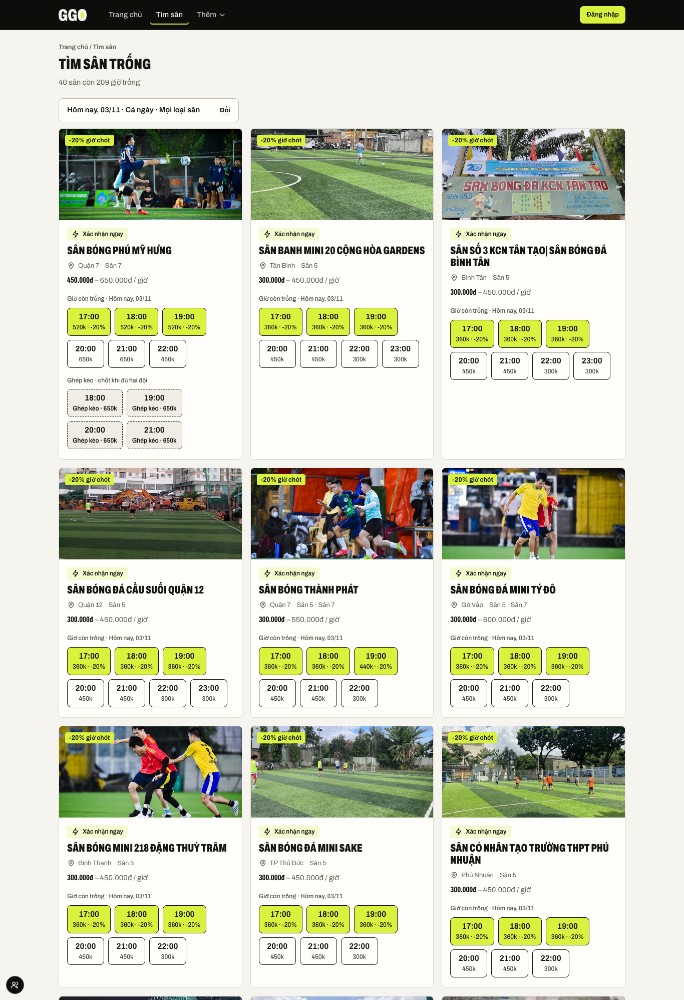

## 4. Trang chi tiết sản phẩm (sân)

- **File:** `public/venue.html`, nội dung dựng bởi `public/js/venue.js`.
- **Có:** ảnh sân (`width`/`height` khai báo, có `alt`), tên, giá (giá từ…/giờ và giá từng ô), mô tả (`venue.description`), thuộc tính: tiện ích (`venue.amenities`), loại sân 5 hoặc 7 người, giờ mở cửa, chính sách hủy, link Google Maps.
- **Nút mua:** nút **Đặt sân** (`#bar-book`, hộp xác nhận `#confirm-dialog`). Trong bản dữ liệu giả, nút này tạo đơn giả, không thanh toán thật.
- **Quay lại danh sách:** có, là breadcrumb "Trang chủ / Tìm sân / tên sân" (`public/js/venue.js` dòng 85), liên kết "Tìm sân" trỏ về `/venues.html`.

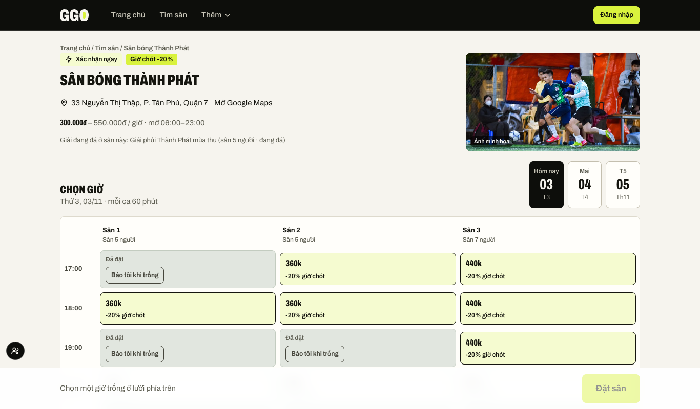

## 5. Trang giới thiệu

- **Có.** File `public/about.html` (script `public/js/about.js` chỉ dựng header và footer chung), dùng chung `public/css/app.css` (khối "Trang giới thiệu" ở cuối file). HTML semantic: `header`, `main`, các `section` có `h2`, `figure`/`figcaption`, `dl` cho thông tin liên hệ. Có title, description, og và canonical riêng, và nằm trong `public/sitemap.xml`.
- **Nội dung trên trang** (căn cứ `docs/PRD.md` mục 1 và 2, chỉ nêu tính năng đã có trên giao diện):
  - **Tiêu đề trang (`h1`):** khẩu hiệu "Thấy sân trống, đặt là đá.", cùng khẩu hiệu ở footer.
  - **Kinh doanh gì:** website đặt sân bóng đá mini 5 và 7 người ở TP.HCM; khách xem giờ trống, giá thật và đặt sân trên web, không cần gọi điện.
  - **Khách hàng là ai:** hai thẻ "Đội đá phủi và nhóm bạn" và "Chủ sân mini".
  - **Điểm nổi bật** (6 mục): tìm theo giờ trước, chọn sân sau; giá thật và giờ chót giảm giá; "Báo tôi khi trống" (danh sách chờ); chuyển khoản VietQR thẳng cho chủ sân, web không giữ tiền; ba cách khác để có sân (Pass sân, Ghép kèo, Nhờ báo giá); Giải đấu phủi.
  - **Ảnh minh họa:** hai ảnh có sẵn trong `public/img/photos/` (`hero-13907438-1600.jpg`, `stats-1400.jpg`), có `alt` mô tả đúng nội dung, có `width`/`height`, hiển thị theo tỉ lệ 3:2 bằng `object-fit: cover` (không méo), chú thích "Ảnh minh họa, không phải ảnh của một sân cụ thể".
  - **Liên hệ:** "Đồ án môn Phát triển ứng dụng TMĐT – Nhóm 8", kèm hai ô giữ chỗ viền nét đứt cho email và điện thoại. Trong HTML có chú thích `CHỦ DỰ ÁN ĐIỀN` ngay trên hai ô này. **Không có email, số điện thoại, địa chỉ hay tên người nào được bịa.**
- **Liên kết tới trang:** (1) trang chủ có liên kết "Tìm hiểu về GGO →" ở cuối nội dung (`public/index.html`), thấy được cả ở 390 px mà không cần mở menu; (2) footer của mọi trang có liên kết "Giới thiệu GGO" (`public/js/ui/shell.js`). Không thêm vào menu chính vì menu khách hàng đã có 7 mục, thêm nữa sẽ sát mép ở khổ 900 px.

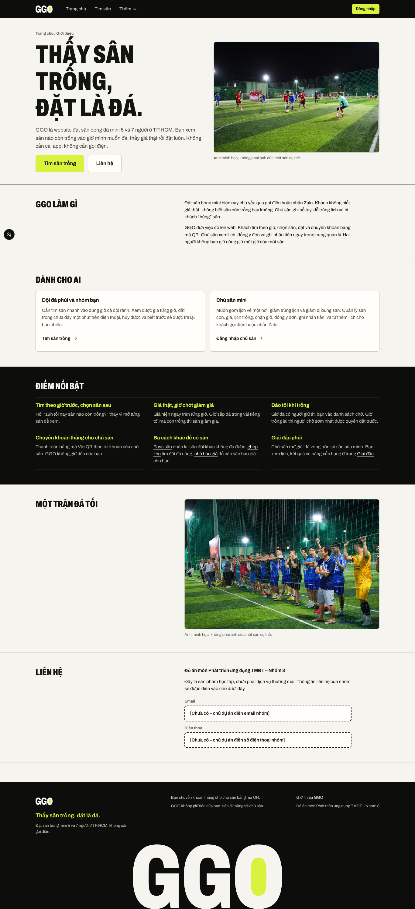

## 6. Responsive – ảnh chụp ở 1366 px, 768 px và 390 px

| Trang | 1366 px | 768 px | 390 px |
| --- | --- | --- | --- |
| Trang chủ |  | 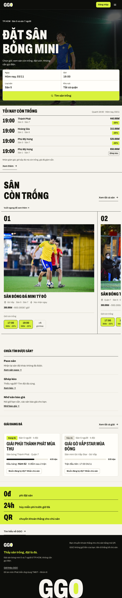 | 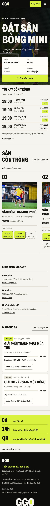 |
| Danh sách sân |  | 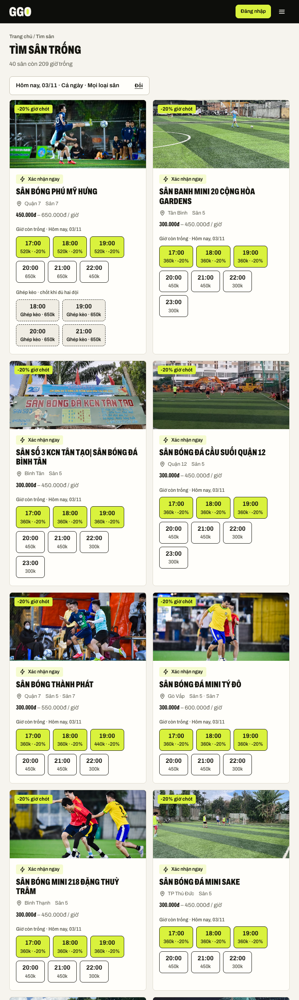 | 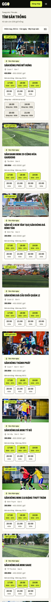 |
| Chi tiết sân |  | 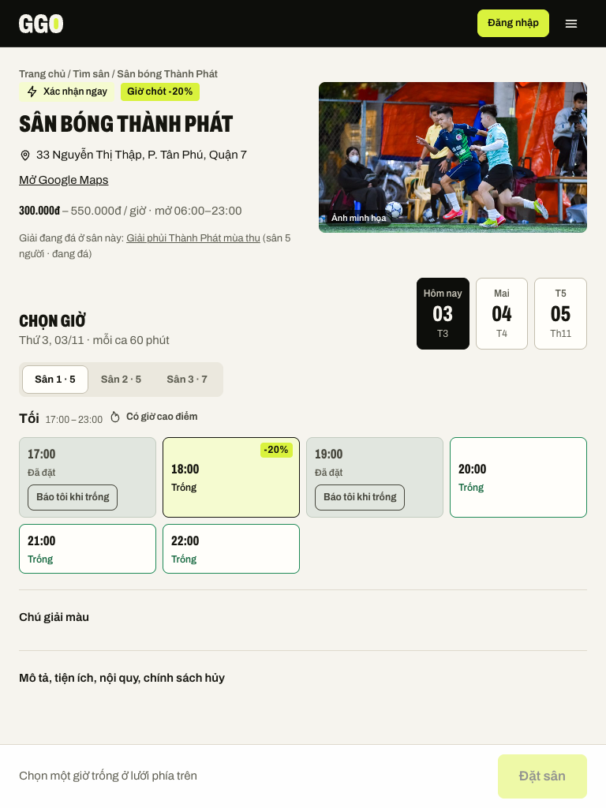 | 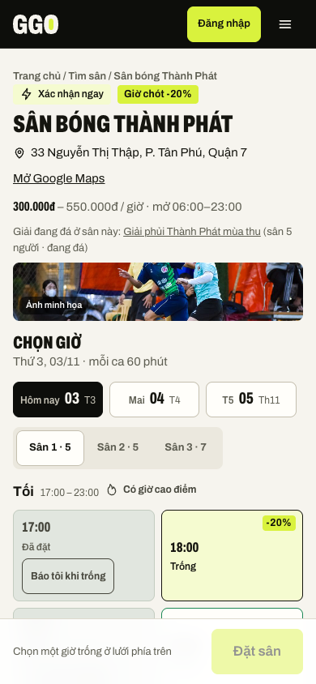 |
| Trang giới thiệu |  | 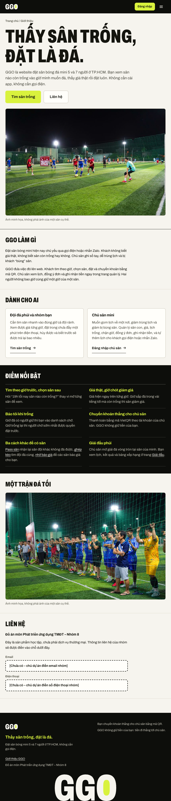 | 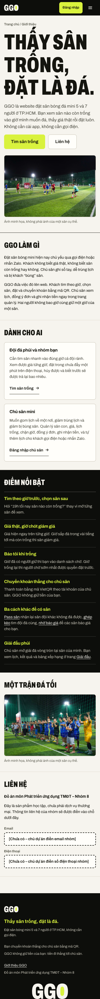 |

Menu trên điện thoại (đã mở): 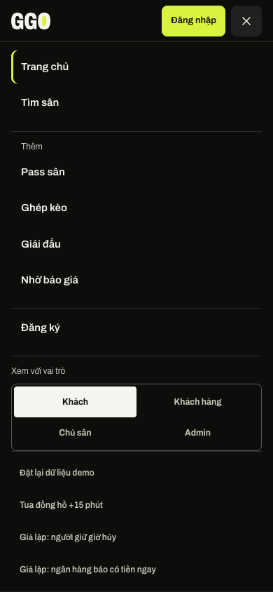

Cơ chế responsive trong mã: `<meta name="viewport" content="width=device-width, initial-scale=1">` ở các trang; `@media` trong `public/css/app.css` (ví dụ `min-width: 720px`, `min-width: 900px`, `min-width: 1100px`, `max-width: 560px`); `.card-grid` đổi 1/2/3 cột; ảnh banner có bản dọc riêng cho màn dưới 640 px.

Trang giới thiệu đo bằng Playwright trên Chrome ở ba khổ: `scrollWidth` bằng `innerWidth` (1366, 768, 390); không có phần tử nào vượt mép; 2 ảnh hiển thị đúng tỉ lệ 3:2 (tỉ lệ gốc 1,50); cột đổi 3 → 2 → 1 ở khối "Điểm nổi bật" và 2 → 1 ở khối "Dành cho ai"; 10 liên kết nội bộ trên trang đều trả 200; console không lỗi.

Danh sách lỗi giao diện ở ba khổ (tràn ngang, ảnh méo, menu chồng lấn…) nằm ở mục 8.

## 7. Hiệu ứng giao diện (hover và focus)

Trong mã (`public/css/app.css`):

- **Focus bàn phím chung:** `:focus-visible { outline: 2px solid var(--focus); outline-offset: 2px; }` (dòng 135–138). Biến `--focus` là mực `#15150f` trên nền sáng và lime `#d9f23d` trên vùng nền tối (header, menu điện thoại, footer, ảnh nền trang chủ, dải đen, giải đấu, hộp thông báo, bảng công cụ demo): dòng 139–161. Dùng `outline` nên không làm xê dịch bố cục.
- **Liên kết menu:** `.nav a:hover` đổi màu, `transition: color` (dòng 307–319).
- **Nút:** `.btn:hover`, `.btn-primary:hover`, `.btn-lime:hover`… đổi viền/nền, `transition: background, border-color` (dòng 651–723).
- **Thẻ sân:** `.card-hover:hover` đổi màu viền, `transition: border-color` (dòng 952–957). **Tên sân trong thẻ:** `.venue-card .title:hover` hiện gạch chân 2 px màu mực, `transition: text-decoration-color` (dòng 989–1001).
- **Ô giờ trên thẻ sân:** `.slot-pill:hover` (dòng 1065).
- **Tôn trọng người giảm chuyển động:** khối `@media (prefers-reduced-motion: reduce)` (dòng 166).

Ảnh minh chứng: mỗi ảnh đặt hai trạng thái cạnh nhau ("Bình thường" và "Hover" hoặc "Focus (Tab)"), chụp ở 1366 px trên bản dữ liệu giả. Vị trí và kích thước phần tử được đo trước và sau: không phần tử nào bị xê dịch.

| Phần tử | Ảnh | Thay đổi đo được |
| --- | --- | --- |
| Liên kết menu (hover) | 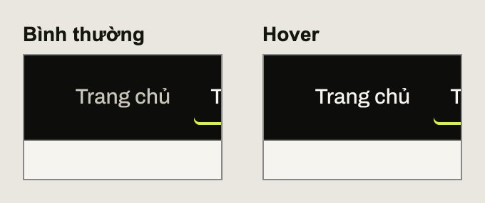 | Chữ "Trang chủ" đổi từ `#c9c6b9` sang `#f6f4ee`, `transition: color 0.18s` |
| Liên kết menu (focus bằng Tab) | 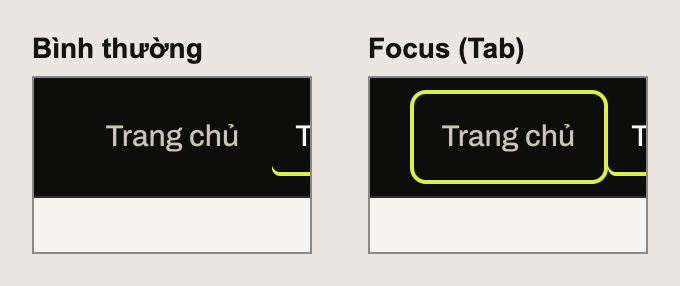 | Có vòng `outline` lime 2 px bo tròn quanh chữ "Trang chủ", nhìn rõ trên nền header tối: tương phản **15,41:1** (trước khi sửa là `#15150f` trên `#0d0e0b`, **1,06:1**). Gạch lime dưới "Tìm sân" (ảnh "Bình thường") là dấu "trang đang mở", không phải dấu focus |
| Nút mở menu ở 390 px (focus bằng Tab) | 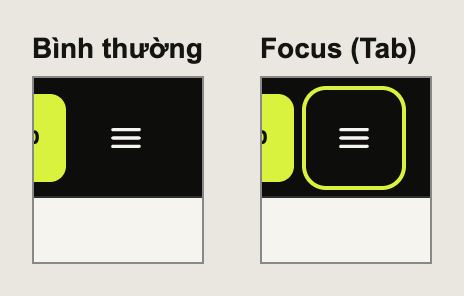 | Vòng lime 2 px quanh nút 44×44 px, tương phản **15,41:1** với header tối (trước: 1,06:1) |
| Nút xem chi tiết: tên sân trong thẻ (hover) | 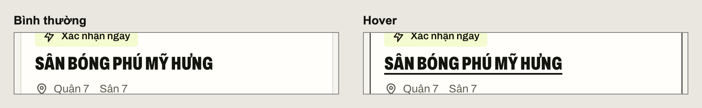 | Gạch chân 2 px đổi từ trong suốt sang `#15150f`, `transition: text-decoration-color 0.18s`; kích thước giữ nguyên 332,7×24,2 px. Viền thẻ chứa nó đổi như thẻ sân. Trước khi sửa: tên sân không đổi gì (`transition: all 0s`) |
| Nút Đặt sân (hover) | 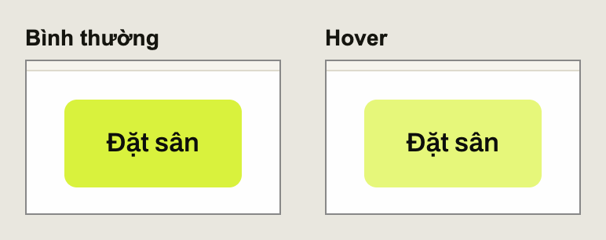 | Nền lime `#d9f23d` nhạt sang `#e6f77a`, `transition: background, border-color 0.18s` |
| Thẻ sân (hover) | 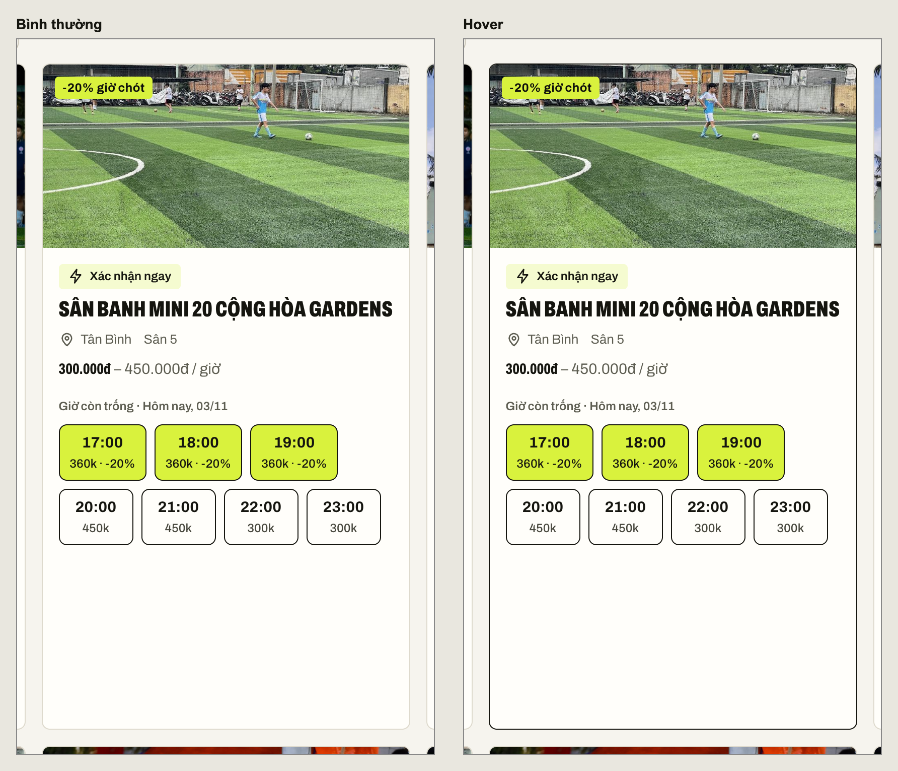 | Viền đổi từ `#dedacd` sang `#15150f`, `transition: border-color 0.18s`, kích thước giữ nguyên 661×367 px |
| Thao tác bàn phím: ô chọn "Giờ đá" ở bộ lọc (focus bằng Tab) | 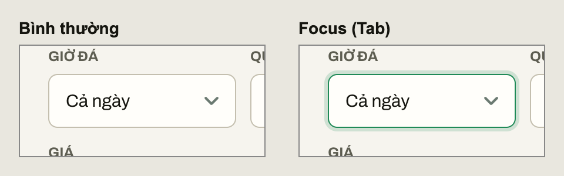 | Viền đổi sang xanh `#1f8a57` kèm vòng bóng 3 px, `transition: border-color, box-shadow 0.18s`; tương phản viền với nền ô 4,31:1 (đạt mức 3:1). Bộ lọc không có ô gõ chữ nên dùng ô chọn |

## 8. Báo cáo kiểm thử

Chỉ ghi những lỗi có bằng chứng trong repo (commit, file e2e, `docs/TASKS.md`). Cách kiểm: các flow trình duyệt tự động trong `e2e/` (Playwright, chạy ở khổ 390 và 1280; `e2e/run-all.mjs` chạy cả bộ), và bộ test backend `npm test` (không thuộc phạm vi giao diện Buổi 2).

### 8.1 Lỗi đã xử lý, có bằng chứng

| # | Lỗi | Ở đâu | Cách xử lý | Kết quả / bằng chứng |
| --- | --- | --- | --- | --- |
| 1 | Trang bị **nhảy bố cục khi tải** (CLS): trong lúc `shell.js` chờ thông tin đăng nhập, ô `#app-header` rỗng, khi header thật hiện ra thì nội dung bị đẩy xuống 60 px | `public/index.html` (`#app-header`), `public/css/app.css` | Commit `3854c05`: chỗ giữ sẵn `#app-header` có đúng chiều cao `var(--header-h)`, nền và viền như header thật | Flow `e2e/f-home.mjs` kiểm hai chỉ số: CLS sau giây thứ 2 < 0.02 và **CLS toàn bộ lúc tải < 0.1** (kiểm thứ hai do commit này thêm vào; trước đó flow bỏ qua 2 giây đầu và ghi chú có lệch 60 px có sẵn). Kết quả chạy `f-home` trên bản dữ liệu giả ngày 03/11: CLS toàn bộ lúc tải **0** ở 390 và **0,0072** ở 1280; CLS từ giây thứ 2 là **0** ở cả hai khổ (cả bốn số đều đạt ngưỡng). Số liệu nằm ở `e2e/out/out-f-home-390.txt` và `out-f-home-1280.txt`; thư mục `e2e/out/` không đưa lên repo, muốn có lại thì chạy `npm run e2e -- f-home 390` |
| 2 | Flow e2e `waitForURL` bằng regex quá rộng có thể khớp nhầm **trang anh em**: `/match` cũng khớp `/matches`, `/match-new`; `/league` khớp `/leagues`, `/owner-league` | `e2e/f-match.mjs`, `f-leagues-public.mjs`, `f-league.mjs`, `f12.mjs`, `f345.mjs`, `f-request.mjs`, `f-live-smoke.mjs` | Regex được neo đuôi bằng `(?=[?#]|$)` và cho phép đuôi `.html` hoặc không, ví dụ `/\/match(\.html)?(?=[?#]|$)/`; riêng chỗ chuyển sang trận mở có thể là `match` hoặc `match-new` thì viết `/\/match(-new)?(\.html)?(?=[?#]|$)/` (`e2e/f-request.mjs` dòng 133) | Các flow dùng dạng neo này (mọi file ở cột "Ở đâu"). **Giới hạn bằng chứng:** các file e2e vào repo lần đầu ở commit `711bc04` đã ở dạng neo, nên repo không có commit "trước/sau" của việc neo này; chỉ thấy commit `c66ed84` nới thêm dạng `(\.html)?` cho `owner-league` và `league`. Lý do khớp nhầm suy ra từ hình dạng regex, chưa có lần chạy lỗi nào được ghi lại trong repo |
| 3 | Đăng nhập xong flow đăng xuất ngay thì các request còn dở của trang đích trả 401 khi chạy với backend thật | `e2e/lib.mjs`, hàm `loginAs` | Commit `3854c05`: thêm `waitForLoadState('networkidle')` sau đăng nhập, kèm ghi chú nêu lý do | Ghi chú trong mã; không có số đo riêng |
| 4 | Câu chào trang chủ theo giờ giả lập không kiểm được trên chế độ thật (backend dùng giờ thật, không đổi được bằng giả đồng hồ trình duyệt) | `e2e/f-home.mjs` | Commit `7dea1e7`: ở chế độ thật chỉ kiểm câu chào theo giờ thật của backend; các giờ giả lập chỉ chạy trên dữ liệu giả | Chú thích đầu khối trong `e2e/f-home.mjs`; thêm smoke `e2e/f-live-smoke.mjs` |

Một ghi nhận khác, không phải lỗi: `docs/TASKS.md` mục T6 ghi "Đã đi trọn luồng 1–5 bằng giao diện với dữ liệu giả ở 390 và 1280", và các mục khác ghi flow kiểm tương ứng (`f-transfer`, `f-match`, `f-request`, `f-stake`, `f-autopay`, `f-league`, `f-leagues-public`, `f-phone`, `f-owner-ux`).

### 8.2 Lỗi giao diện ở 1366 / 768 / 390 px

Đo lại ngày 04/11 từ `main` (sau đợt cải thiện trải nghiệm, mục 8.3) trên bản dữ liệu giả chạy ở máy (`npm run prototype`, cổng 4100), bằng Playwright trên Chrome, cho 3 trang (trang chủ, danh sách sân, chi tiết sân `venue.html?id=1`) ở 3 khổ 1366 / 768 / 390 px. Sau lần đo đầu, lỗi 1, 2 và 5 đã được sửa bằng CSS (`public/css/app.css`) và đo lại; lỗi 3 được xử lý bằng trang giới thiệu (mục 5); lỗi 4 giữ nguyên vì cố ý theo thiết kế.

**Đạt (không có lỗi):**

| Tiêu chí của đề | Kết quả đo |
| --- | --- |
| Không tràn ngang | `scrollWidth` bằng `innerWidth` ở cả 9 trường hợp (3 trang × 3 khổ). Ở 768 và 390 px, các thẻ của băng "Sân còn trống" ở trang chủ vượt mép phải nhưng nằm trong khung cuộn ngang riêng (cố ý), không tạo thanh cuộn ngang cho cả trang |
| Ảnh không méo | 9 ảnh ở trang chủ, 40 ở danh sách, 1 ở chi tiết (cả 50 ảnh đều có `alt`, `width`, `height`, tải được): tỉ lệ hiển thị khớp tỉ lệ gốc hoặc dùng `object-fit` đúng |
| Danh sách đổi số cột | Danh sách sân: 3 cột ở 1366, 2 cột ở 768, 1 cột ở 390 |
| Menu không chồng lấn | Header cao 60 px ở cả 3 khổ, không có cặp phần tử nào chồng lên nhau. 1366: menu ngang (Trang chủ, Tìm sân, Thêm) + nút Đăng nhập; 768 và 390: gọn vào nút menu (ảnh `trang-chu-390-menu.png`), mỗi mục cao 47 px (6 mục: Trang chủ, Tìm sân, rồi Pass sân, Ghép kèo, Giải đấu, Nhờ báo giá dưới nhãn "Thêm") |
| Banner không mất nội dung | Ảnh nền, tiêu đề và nút "Tìm sân trống" nằm trọn trong khung ở cả 3 khổ |
| Liên kết trỏ tới trang thật | Trang chủ 25, danh sách 259, chi tiết 11 liên kết nội bộ khác nhau: tất cả trả 200, không có liên kết chết |

**Lỗi và điểm chưa đạt:**

| # | Lỗi | Trang / khổ | Cách xử lý | Kết quả (số đo trước → sau) |
| --- | --- | --- | --- | --- |
| 1 | Một số nút **nhỏ hơn 44 px** (mức thường khuyên cho vùng bấm trên điện thoại) | 390 px: nút Đăng nhập, chip lọc ở danh sách, nút "Báo tôi khi trống", nút mở menu | **Đã xử lý.** Khối `@media (max-width: 639.98px)` ở cuối `public/css/app.css` (dòng 3338–3351) đặt `min-height: 44px` cho `.btn-sm`, `.chip`, `.segmented button`, `.slot .wait-btn`, `.role-switch button`, `.proto-tools button` và nút menu 44×44 px; ô chọn ở khung tìm kiếm trang chủ được kéo phủ cả ô để vùng bấm cao 48 px mà ô giữ nguyên kích thước (dòng 1426–1435) | Đăng nhập 91×34 → 91×44 px; chip lọc 36 → 44 px; "Báo tôi khi trống" 114×33 → 114×44 px; nút menu 40×40 → 44×44 px. Rà thêm cả 3 trang ở 390: "Muốn đăng ký đội?" 34 → 44; nút chọn sân (Sân 1 · 5…) và "Tất cả / Sân 5 / Sân 7" 36 → 44; 4 ô chọn ở trang chủ 26 → 48 px; nút chọn vai trò và nút giả lập (chỉ có trên dữ liệu giả) 39 → 44. Sau khi sửa không còn nút hay ô chọn nào dưới 44 px trên 3 trang; không tràn ngang ở 9 trường hợp |
| 2 | Tên sân (đóng vai trò liên kết xem chi tiết) **không có hiệu ứng hover riêng**; chỉ thẻ chứa nó đổi viền | Danh sách sân, mọi khổ | **Đã xử lý.** `.venue-card .title` có gạch chân 2 px trong suốt, `.venue-card .title:hover` đổi màu gạch chân sang mực, `transition: text-decoration-color var(--dur)` (`public/css/app.css` dòng 989–1001). Không đổi cỡ chữ hay độ đậm | Trước: màu và gạch chân không đổi, `transition: all 0s`. Sau: gạch chân từ trong suốt sang `#15150f`, `transition: text-decoration-color 0.18s`; kích thước trước/sau hover giữ nguyên 332,7×24,2 px, vị trí không đổi; ảnh `hover-xem-chi-tiet.png` |
| 3 | Trang chủ **chưa có liên kết tới trang giới thiệu** | Trang chủ | **Đã xử lý.** Thêm trang `public/about.html` (mục 5), liên kết "Giới thiệu GGO" ở footer mọi trang (`public/js/ui/shell.js`) và liên kết "Tìm hiểu về GGO →" ở cuối trang chủ (`public/index.html`). Không đặt vào menu trên cùng vì ở khổ 900 px menu sẽ bị tràn | Trước: không có trang giới thiệu trong `public/`. Sau: trang có và trả 200, đã thêm vào `public/sitemap.xml`; hai liên kết trên đều trỏ tới `about.html` |
| 5 | **Vòng focus gần như không thấy trên nền tối**: quy tắc chung `:focus-visible { outline: 2px solid var(--text) }` dùng màu `#15150f` trên nền header `#0d0e0b` | Header và menu điện thoại, mọi khổ (liên kết menu, logo, nút Đăng nhập, nút mở menu, mục trong menu, nút khung tìm kiếm trang chủ) | **Đã xử lý.** Vòng focus dùng biến `--focus`: mực trên nền sáng, lime `#d9f23d` trên các vùng nền tối (dòng 135–161). Khung tìm kiếm trang chủ (nền trắng nằm trong ảnh tối) trả lại mực; nút trong khung đó vẽ vòng vào trong nút (`outline-offset: -4px`) vì khung cắt phần vẽ ra ngoài. Nút công cụ demo nổi vẽ vòng lime sát nút (dòng 463–467). Khi kiểm còn phát hiện và sửa thêm hai lỗi cùng nhóm: menu điện thoại đóng vẫn nhận phím Tab dù đã mờ hẳn (nay `visibility: hidden` khi đóng, dòng 401), và header dính che phần tử đang focus khi Tab ngược (`scroll-padding-top` ở dòng 98) | Đo bằng ảnh chụp thật ở mỗi lần Tab, lấy màu nền ngay quanh vòng (3 trang, 390 và 1366, Tab xuôi và ngược, trước 363 mẫu, sau 355 mẫu có vòng): tương phản vòng với nền **trước: 1,06:1** ở header (135 mẫu dưới 3:1); **sau: 15,41:1** trên nền tối, 14,59:1 (vòng mực vào trong nút lime), 16,66–18,16:1 trên nền sáng (liên kết, thẻ, nút Đặt sân). Còn 5 mẫu bị đánh dấu là nút công cụ demo (chỉ có trên dữ liệu giả): vòng sát nút đen nên tương phản đo với chính nút là 15,41:1, không đo với nền trang. Ảnh `focus-lien-ket-menu.png`, `focus-nut-menu.png` |
| 4 | Ở 768 và 390, mục "Sân còn trống" của trang chủ là **băng cuộn ngang** (có chữ "Vuốt ngang để xem thêm"), nên ảnh chỉ thấy 1–2 thẻ | Trang chủ, 768 / 390 | Cố ý theo thiết kế; nêu rõ khi nộp để người chấm không hiểu là thiếu nội dung | Ở 1366 hiện đủ 3 thẻ trên một hàng |
| 6 | Ba chip chọn ngày ở trang chi tiết sân cao **41 px** ở 390 px, thấp hơn mức 44 px (phát hiện khi đo lại sau đợt cải thiện) | Chi tiết sân, 390 px | **Đã xử lý** (commit `8838bcc`): chip cao tối thiểu 44 px ở 390 px | 41 px → 44 px |

**Ghi chú cho người xem ảnh:**
- Ảnh chụp bản dữ liệu giả nên có thêm thanh "vai trò demo" ở góc dưới và nút giả lập trong menu; bản thật không có các phần này.
- Trang chi tiết dùng breadcrumb "Trang chủ / Tìm sân / Tên sân" làm liên kết quay lại, không có nút "← Quay lại" riêng. Nút "Đặt sân" nằm ở thanh cố định cuối màn hình và chỉ bật khi đã chọn một giờ trống.

### 8.3 Cải thiện trải nghiệm đặt sân

**Vấn đề.** Khi cả luồng đã chạy được, nhóm đi thử một lượt từ trang chủ tới lúc có đơn (tìm sân, chọn giờ, đăng nhập, xác nhận, trang đơn) và thấy năm chỗ vướng:

- Ở bản cũ, trang chủ dài; chữ lớn nhất là câu hỏi "Tối nay đá ở đâu?" thay vì nói thẳng việc đặt sân; giờ còn trống nằm sau nhiều màn cuộn.
- Trang kết quả tìm sân: giờ trống đầu tiên nằm ngoài màn đầu ở 390 px (126% chiều cao màn hình) và sát mép dưới ở 1366 px (99%).
- Bấm **Đặt sân** khi chưa đăng nhập thì phải đăng nhập rồi tự tìm lại sân, giờ và bấm lần nữa.
- Ở bản cũ, nhãn "Đặt là chốt" và trạng thái "đã có sân" khi chưa chuyển khoản dễ hiểu nhầm là đã giữ chỗ xong.
- Ở bản cũ, header hiện chữ "Đang tải…" trong lúc chờ, và các mục phụ (Pass sân, Ghép kèo, Giải đấu) nằm ngang hàng với mục chính.

**Cách sửa** (đã có trên `main`, bản mẫu đã đưa lên ggo-datsan.pages.dev):

- **Trang chủ:** chữ lớn nhất là "Đặt sân bóng mini"; giờ còn trống nằm ngay màn đầu; bỏ dải chữ chạy và khối giờ chót trùng lặp. Ba điều cần biết (0đ phí đặt sân, hủy miễn phí 24h, QR chuyển thẳng cho chủ sân) gọn lại thành một dải nền lime ở cuối trang.
- **Menu:** mục **Thêm** gom Pass sân, Ghép kèo, Giải đấu và Nhờ báo giá; header không còn hiện "Đang tải…".
- **Kết quả tìm sân:** hiện luôn các giờ trống trên thẻ; bộ lọc thu gọn thành một dòng tóm tắt (bấm "Đổi" để mở). Thanh đặt sân ghi tên sân, giờ và giá.
- **Đăng nhập:** nhập số điện thoại hoặc email; trang nói rõ đang đặt sân nào, giờ nào; đăng nhập xong tự quay lại hộp xác nhận. Đăng ký còn 3 ô.
- **Giữ sân 15 phút** trong lúc chờ chuyển khoản, nhãn "Đang giữ sân · chuyển khoản trước HH:mm". Hộp xác nhận nói hạn chuyển khoản trước, chính sách hủy sau.
- **Lịch ngoài thời hạn đặt** hiện "Ngoài thời hạn đặt" thay vì để trống.

**Số đo.** Do một kịch bản tự động (`e2e/ux-measure.mjs`) đo trên bản dữ liệu mẫu ở máy, mỗi bản một lần, nên chỉ dùng để so trước và sau, không phải tốc độ trên mạng thật.

*Bảng 8.3. Đo trước và sau cải thiện (trước: commit `a8085ce`; sau: `main`)*

| Chỉ số | 390 px | 1366 px |
| --- | --- | --- |
| Số lần bấm cho tới khi có đơn (kèm số ô phải nhập) | 6 + 2 ô → 5 + 2 ô | 6 + 2 ô → 5 + 2 ô |
| Giờ trống đầu tiên ở trang kết quả, tính theo chiều cao màn hình (trên 100% là phải cuộn) | 126% → 72% | 99% → 68% |
| Chiều dài trang chủ | 4731 → 3768 px | 3779 → 2932 px |
| Header và logo hiện ra sau | 284 → 59 ms | 109 → 57 ms |

Ở trang sân, 390 × 844 px: hàng giờ đầu tiên trước đây nằm ở y 750–816 và bị thanh đặt sân (y 763) che một phần; nay ở y 627–693 (đo sau khi chip ngày cao thêm lên 44 px), không bị che vì thanh đặt sân vẫn ở y 763. Ở 1366 px không đổi (y 489–553).

**Ảnh trước và sau.** Ảnh chụp cùng một kịch bản cho cả hai bản (trước từ commit `a8085ce`, sau từ `main`), chỉ lấy màn hình đầu của mỗi bước. Kịch bản bấm vào giờ đầu tiên của sân đầu tiên trong kết quả nên hai bên có thể rơi vào hai sân khác nhau; so bố cục và chữ, không so tên sân. Ở bản trước, sau khi đăng nhập trang không tự mở hộp xác nhận nên kịch bản phải quay lại sân và bấm Đặt sân lần nữa; ảnh "Hộp xác nhận" của bản trước chụp sau bước đó.

*Khổ 390 px, màn hình đầu của từng bước.*

| Bước | Trước | Sau |
| --- | --- | --- |
| Tìm sân | 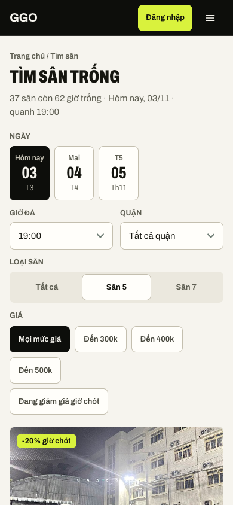 | 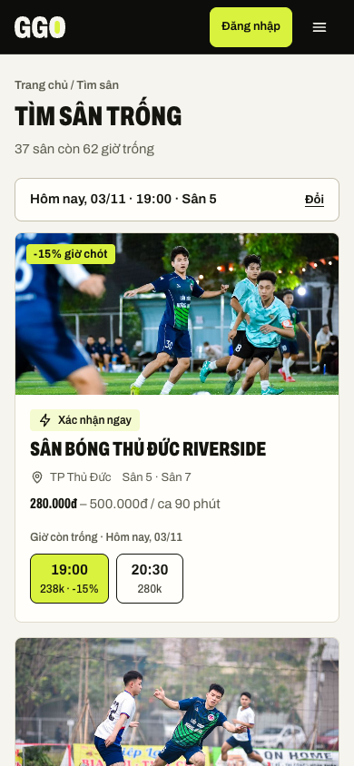 |
| Trang sân | 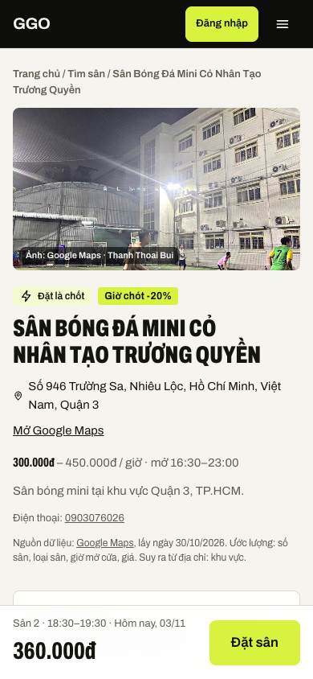 | 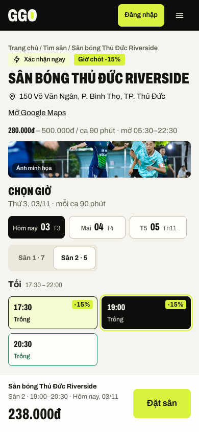 |
| Đăng nhập | 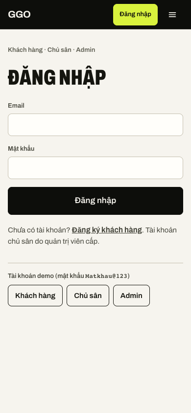 | 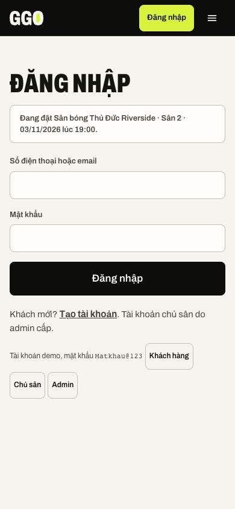 |
| Hộp xác nhận | 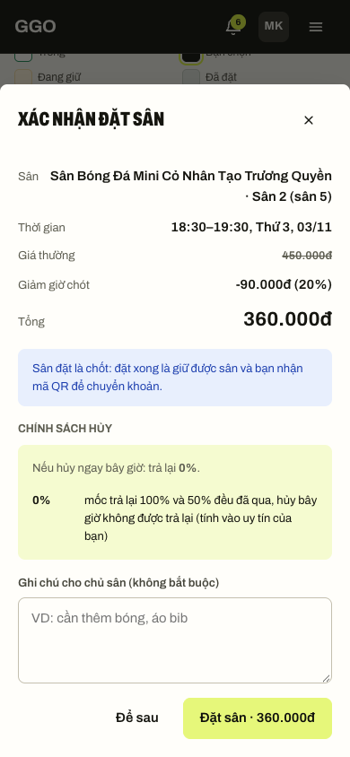 | 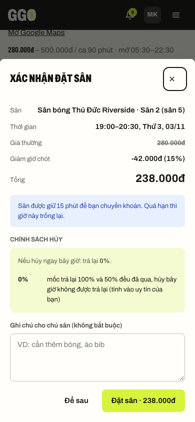 |
| Trang đơn | 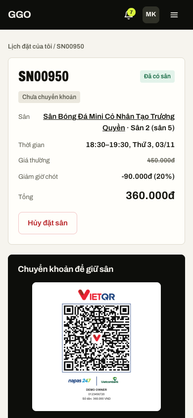 | 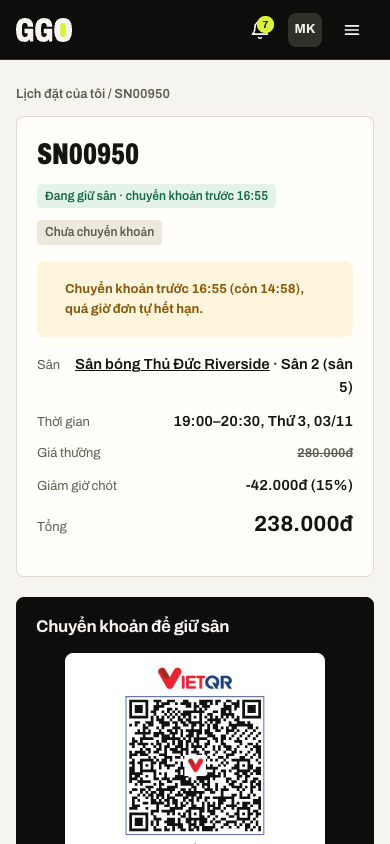 |

*Khổ 1366 px, màn hình đầu của từng bước.*

| Bước | Trước | Sau |
| --- | --- | --- |
| Tìm sân | 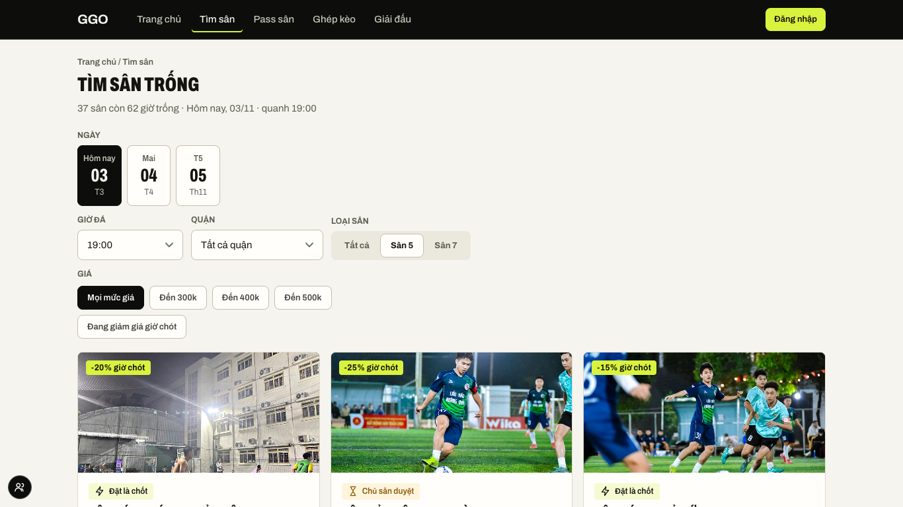 | 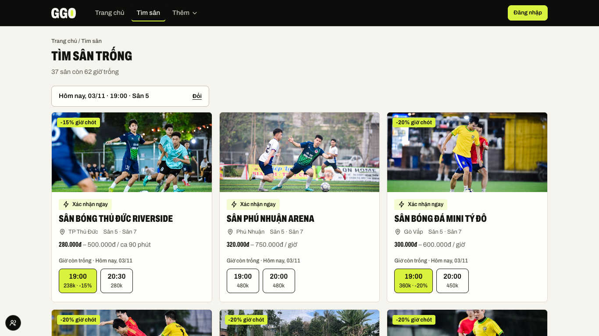 |
| Trang sân | 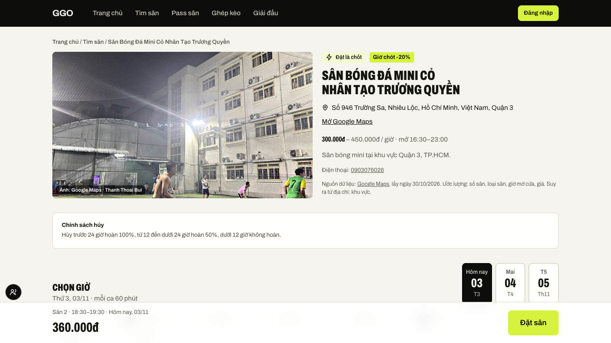 | 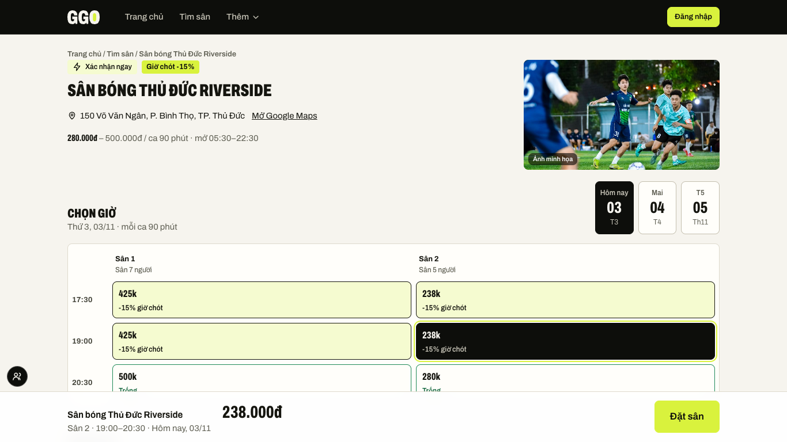 |
| Đăng nhập | 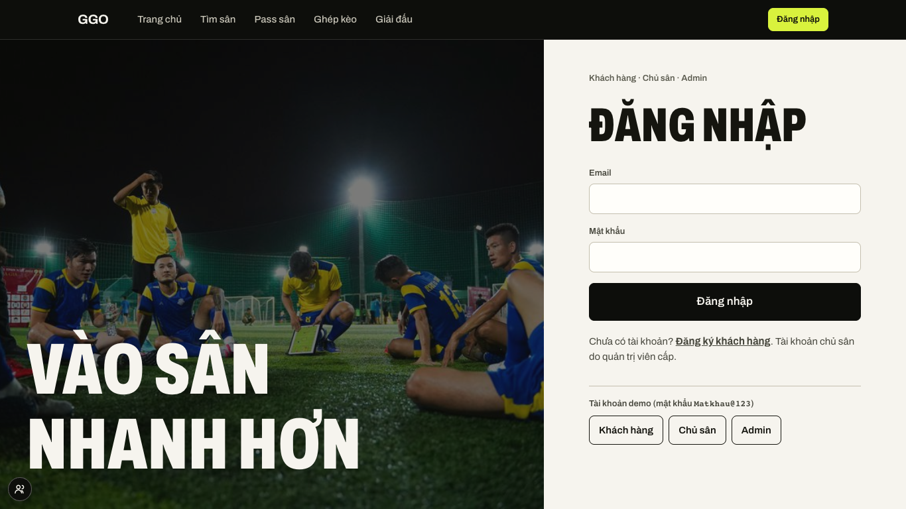 | 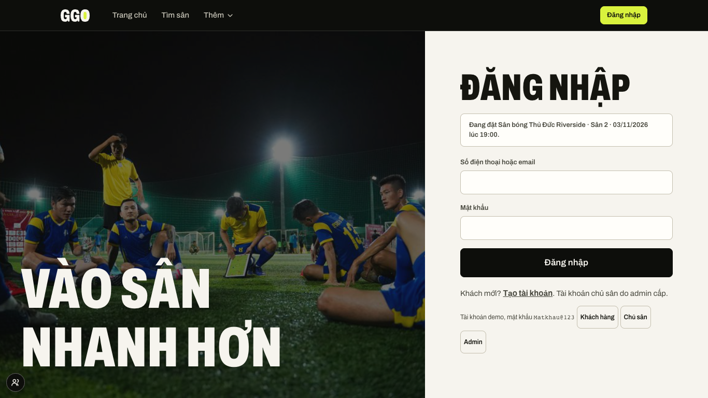 |
| Hộp xác nhận | 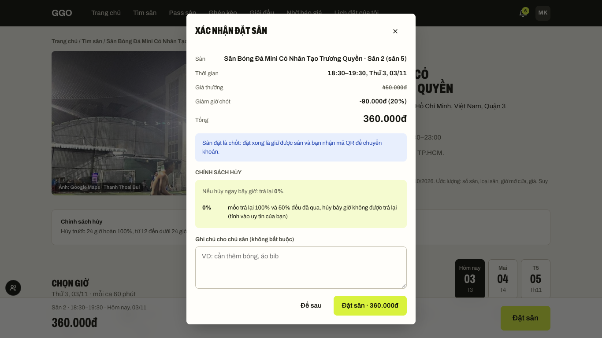 | 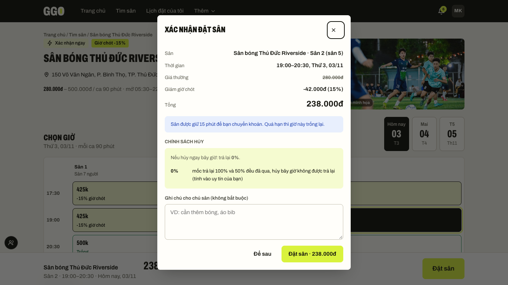 |
| Trang đơn | 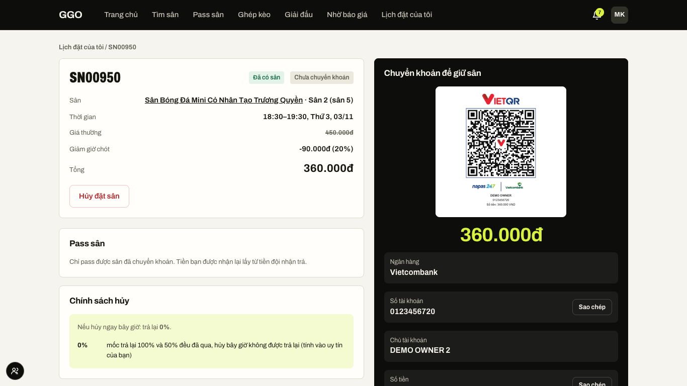 | 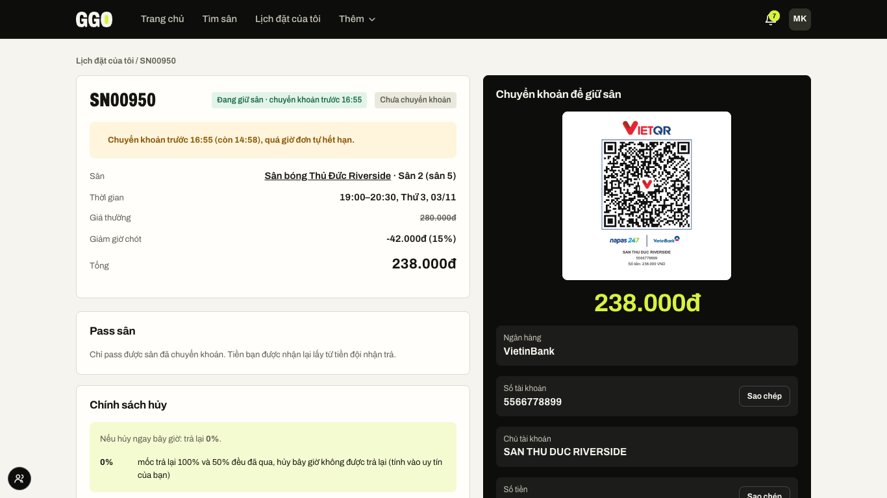 |

**Giới hạn của kết quả.** Các số trên đến từ kịch bản đo tự động. Ngoài ra nhóm cho một tác tử "đọc mù" (chỉ nhìn chuỗi ảnh, chưa đọc mã) nhận xét luồng. Câu trả lời: "Nhìn cả chuỗi thì hiểu đây là web tìm sân bóng, chọn sân và giờ, đăng nhập, xác nhận rồi chuyển khoản để giữ sân. Luồng nhìn chung theo thứ tự hợp lý; vướng nhất là ý nghĩa trạng thái "đã có sân" khi chưa chuyển khoản, và việc phân biệt chọn giờ/đặt xong/giữ chỗ chính thức." Sau đó nhãn được đổi thành "Đang giữ sân · chuyển khoản trước HH:mm" và "Xác nhận ngay" để sửa đúng chỗ đó. **Chưa thử với người thật.** Phiếu `docs/ux-test.md` là biểu mẫu để nhóm mời 5 người thử trước và sau; khi có kết quả thì mới có thể nói người dùng thấy dễ hơn.

## 9. Báo cáo sử dụng AI

**Ghi trung thực:** website này được làm với sự hỗ trợ **lớn** của AI agent (viết mã, viết test e2e, sửa lỗi, soạn tài liệu); các thành viên điều hướng, duyệt và quyết định. Các ví dụ dưới đây chỉ dùng những việc kiểm được qua commit hoặc file trong repo. Phần "từng thành viên hiểu mã mình làm" do từng thành viên tự viết ở mục 12; ví dụ ở đây không gán cho ai.

### Ví dụ 9.1 – Đề xuất bị **loại bỏ**: chờ cứng bằng `waitForTimeout` trong flow e2e

- **Vấn đề AI đề xuất:** ở bản flow "kèo tiền sân" (một bản sao từ flow cũ), sau khi bấm nút "Đã nhận" hoặc nút chốt kết quả, đợi một khoảng thời gian cố định bằng `waitForTimeout(...)` rồi mới đọc kết quả.
- **Vị trí mã:** `e2e/f-stake.mjs`, bước `05-winner-presses-received` (dòng 106–107) và bước chốt kết quả của chủ sân (dòng 141–142).
- **Đã kiểm trên trình duyệt thế nào:** chạy flow trên Chrome bằng Playwright ở khổ 390 và 1280. Chờ cứng làm kết quả phụ thuộc tốc độ máy: nhanh thì chờ thừa, chậm thì đọc quá sớm. Ở bước 05 còn một bẫy: nhãn nút "Đã nhận …" **có sẵn trước khi bấm**, nên không dùng chữ trên nút để biết thao tác đã xong (ghi chú trong mã).
- **Quyết định:** **loại bỏ** cách chờ cứng.
- **Thay đổi và kết quả:** đổi sang chờ tín hiệu thật là **toast thành công** (`.toast:not(.error)` chứa "Đã ghi nhận đã nhận tiền" / "Đã chốt kết quả"); bước chốt kết quả còn chờ hộp thoại đóng (`!document.querySelector('dialog[open]')`). Cả hai dòng có chú thích lý do ngay trên mã. **Giới hạn:** repo không giữ bản chờ cứng cũ (flow vào repo đã ở dạng chờ toast, commit `711bc04`), nên bằng chứng là chú thích và mã hiện tại. Một `waitForTimeout(400)` còn lại ở dòng 139 chỉ để đợi hoạt ảnh hộp thoại xong trước khi chụp ảnh, không dùng để chờ kết quả.

### Ví dụ 9.2 – Đề xuất được **áp dụng**: chừa chỗ cho header để trang không nhảy khi tải

- **Vấn đề AI đề xuất:** nội dung trang bị đẩy xuống 60 px khi header dựng xong; đề xuất giữ sẵn chỗ cho header và đo CLS ngay từ lần vẽ đầu tiên, thay vì bỏ qua 2 giây đầu như flow cũ.
- **Vị trí mã:** `public/css/app.css` (khối `#app-header`, ngay trên khối `/* ---------- Header ---------- */`); `e2e/f-home.mjs` (đo `window.__clsAll`).
- **Đã kiểm trên trình duyệt thế nào:** flow `e2e/f-home.mjs` dùng `PerformanceObserver` loại `layout-shift` trong Chrome, hai chỉ số: CLS sau giây thứ 2 (< 0.02) và CLS toàn bộ lúc tải (< 0.1).
- **Quyết định:** **áp dụng**, vì trước đó chính flow kiểm đã phải ghi chú "lúc nạp có lệch 60px do header dựng, có sẵn từ trước" (nội dung dòng bị xóa trong commit `3854c05`), tức lỗi có thật chứ không chỉ là lý thuyết.
- **Thay đổi và kết quả:** commit `3854c05` (3 file, +12/−2). Chỗ giữ sẵn có cùng chiều cao, màu nền và viền với header. Kết quả chạy xem `e2e/out/out-f-home-390.txt`, `out-f-home-1280.txt`.

### Ví dụ 9.3 – Đề xuất được **áp dụng**: chặn request không đến từ proxy (phần backend)

- Ví dụ này thuộc backend nên **ngoài phạm vi đề Buổi 2**; ghi để minh bạch cách dùng AI, nhóm có thể bỏ nếu không muốn nộp phần này.
- **Vấn đề:** khi mở backend ra mạng qua tunnel, ai biết link cũng gọi thẳng được.
- **Vị trí mã:** `src/middleware/proxy.js`, `src/productionCheck.js`, `src/app.js`; test `tests/production.test.js`.
- **Đã kiểm:** test tự động và chạy server production thật, thấy không có header bí mật thì trả 404 trống, có thì `/api/venues` trả 200 (commit `7dea1e7`).
- **Quyết định:** áp dụng; **thay đổi:** thêm cổng kiểm header và bắt server từ chối khởi động khi cấu hình yếu.

## 10. README

`README.md` có mục **"Phạm vi Buổi 2 (HTML & CSS)"** ngay sau phần giới thiệu, gồm: các trang nộp (`index.html`, `venues.html`, `venue.html`, `about.html`), danh sách trang, **cách xem** (`npm run prototype` rồi mở http://localhost:4100, hoặc bản deploy https://ggo-datsan.pages.dev), **cách kiểm responsive** (DevTools ở 1366 / 768 / 390 px và các điểm cần kiểm) và **hạn chế hiện tại** (dữ liệu giả lưu trong trình duyệt, cần JavaScript, phần Express + MySQL là mở rộng ngoài phạm vi Buổi 2, thông tin liên hệ trang giới thiệu chưa điền).

Đối chiếu với nội dung đề yêu cầu (bước 9C):

| Nội dung đề yêu cầu | Trong README | Đánh giá |
| --- | --- | --- |
| Giới thiệu | Đầu file: đồ án, khách/chủ sân/admin làm gì | Có |
| Cấu trúc thư mục | Mục "Cấu trúc" (viết cho cả dự án, chưa kể `e2e/`, `functions/`, `docs/`) | Một phần |
| Danh sách trang | Mục "Phạm vi Buổi 2" → "Danh sách trang" | Có |
| Công nghệ | Bảng "Công nghệ" | Có |
| Cách mở/chạy | "Phạm vi Buổi 2" → "Cách xem" (bản dữ liệu giả, không cần CSDL); "Chạy trên máy" cho bản có backend | Có |
| Cách kiểm responsive | "Phạm vi Buổi 2" → "Cách kiểm responsive" | Có |
| Hạn chế hiện tại | "Phạm vi Buổi 2" → "Hạn chế hiện tại" | Có |

Lưu ý: đề dặn không khẳng định có backend/CSDL/thanh toán theo phạm vi Buổi 2. README vẫn giữ các mục về backend vì đó là mã có thật trong repo, và ghi rõ đó là phần mở rộng ngoài phạm vi Buổi 2.

## 11. Bảng phân công

Để trống, không đoán tên.

| Thành viên | Nhiệm vụ | File/trang phụ trách |
| --- | --- | --- |
| **[ĐIỀN]** | | |
| **[ĐIỀN]** | | |
| **[ĐIỀN]** | | |
| **[ĐIỀN]** | | |

## 12. Câu hỏi kiến thức (mỗi thành viên tự trả lời theo phần mình làm)

Sáu câu của bước 10 (chép nguyên từ `docs/buoi2/de-bai.md`):

1. **Giải thích mã nguồn:** chọn một đoạn HTML và một đoạn CSS em làm; giải thích vai trò các thẻ, ý nghĩa ít nhất 3 thuộc tính CSS, ảnh hưởng tới giao diện.
2. **Dự đoán kết quả:** `.product-list { display: grid; grid-template-columns: repeat(4, 1fr); gap: 16px; }` — đổi `repeat(4, 1fr)` thành `repeat(2, 1fr)` thì giao diện đổi thế nào, vì sao?
3. **Phát hiện lỗi:** `.product-image { width: 100%; height: 250px; }` làm ảnh bị kéo giãn — đề xuất sửa thế nào, giải thích thuộc tính thêm vào.
4. **Quyết định kỹ thuật:** phần em phụ trách dùng Grid hay Flexbox, vì sao? Nêu một tình huống phương án kia phù hợp hơn.
5. **Kiểm tra responsive:** web tràn ngang ở 390 px thì kiểm thành phần nào trước, dùng công cụ gì?
6. **Đánh giá nội dung AI:** một đề xuất AI em đã dùng/điều chỉnh/loại bỏ — đề xuất là gì, kiểm bằng cách nào, kết quả thực tế, rút ra điều gì.

Mỗi thành viên một khối (nhân bản khối dưới cho từng người):

### Thành viên: **[ĐIỀN tên]**

- Câu 1: **[ĐIỀN]**
- Câu 2: **[ĐIỀN]**
- Câu 3: **[ĐIỀN]**
- Câu 4: **[ĐIỀN]**
- Câu 5: **[ĐIỀN]**
- Câu 6: **[ĐIỀN]**

---

## Việc chủ dự án phải tự làm hoặc tự quyết

### A. Danh sách việc

1. **Link GitHub:** điền link repo Buổi 1 (mục 1); thêm remote và đẩy mã; kiểm giảng viên mở được repo.
2. **Trang giới thiệu:** trang đã có (`public/about.html`, mục 5). Chỉ còn việc chủ dự án đọc lại nội dung và điền email, số điện thoại thật vào hai ô giữ chỗ ở phần "Liên hệ" (tìm chú thích `CHỦ DỰ ÁN ĐIỀN` trong file). Nếu không có thông tin để điền thì xóa hai ô đó, trang vẫn còn dòng "Đồ án môn Phát triển ứng dụng TMĐT – Nhóm 8".
3. **Điền bảng phân công (mục 11) và 6 câu trả lời của từng thành viên (mục 12).** Phần này phải do từng người tự viết.
4. **Câu hỏi kiểm tra ở từng bước (1–9):** đề không nói rõ có phải nộp không (mục 12 của đề chỉ ghi "6 câu"). Cần hỏi giảng viên hoặc tự quyết.
5. **Định dạng nộp:** đề không quy định (Docs hay PDF).
6. **Phần backend vượt phạm vi:** đã chốt. README có mục "Phạm vi Buổi 2" ghi phần Express + MySQL là mở rộng ngoài phạm vi; tài liệu này ghi tương tự ở phần "Phạm vi công nghệ".
7. **Ví dụ AI ở mục 9:** duyệt, và quyết định giữ hay bỏ ví dụ 9.3 (backend, ngoài phạm vi).
8. **Lỗi giao diện ở mục 8.2:** ba lỗi CSS (nút nhỏ hơn 44 px trên điện thoại, tên sân thiếu hover, vòng focus trên nền tối khó thấy) đã được sửa và đo lại; chỉ còn việc chủ dự án đọc lại. Lỗi 3 (chưa có trang giới thiệu) cũng đã xử lý bằng trang `about.html` và hai liên kết tới nó. Còn một điểm giữ nguyên vì cố ý theo thiết kế: băng cuộn ngang ở trang chủ trên 768 / 390 px (lỗi 4).

### B. Nội dung trang giới thiệu (đã làm; chỉ còn thông tin liên hệ)

Trang `public/about.html` đã làm theo đề xuất dựa trên `docs/PRD.md`. Đối chiếu với các ý đề yêu cầu:

| Ý đề yêu cầu | Trên trang | Trạng thái |
| --- | --- | --- |
| Kinh doanh gì | Mục "GGO làm gì" và đoạn mở đầu: website đặt sân bóng đá mini 5 và 7 người ở TP.HCM, không cần gọi điện (PRD mục 1) | Xong |
| Khách hàng là ai | Mục "Dành cho ai": đội đá phủi và nhóm bạn; chủ sân mini (PRD mục 1 "Vấn đề", mục 2) | Xong |
| Điểm nổi bật | Mục "Điểm nổi bật", 6 mục, chỉ gồm tính năng đã có trên giao diện | Xong |
| Ảnh minh họa | 2 ảnh trong `public/img/photos/`, có `alt`, ghi chú là ảnh minh họa (PRD mục 10, câu 4 về ảnh tự vẽ hay ảnh thật vẫn còn mở) | Xong |
| Thông tin liên hệ | "Đồ án môn Phát triển ứng dụng TMĐT – Nhóm 8" và hai ô giữ chỗ email, điện thoại | **Chờ chủ dự án điền** email nhóm, số điện thoại (không có địa chỉ vì chưa có thật; không tự bịa) |

---

## Phụ lục: đối chiếu nhanh 12 mục

| # | Mục | Trạng thái | Bằng chứng |
| --- | --- | --- | --- |
| 1 | GitHub | Thiếu | `git remote -v` rỗng |
| 2 | Trang chủ | Có | `public/index.html`, `shell.js`; có liên kết tới trang giới thiệu (cuối trang và footer) |
| 3 | Danh sách sân | Có | `public/venues.html`, `.card-grid`, 40 sân trong `public/mock/venues.json` |
| 4 | Chi tiết sân | Có | `public/venue.html`, `public/js/venue.js` |
| 5 | Giới thiệu | Có, chờ thông tin liên hệ | `public/about.html`; chỉ còn email và số điện thoại để chủ dự án điền (hai ô giữ chỗ) |
| 6 | Responsive | Có | ảnh 4 trang × 3 khổ trong `screens/` (trang chủ, danh sách, chi tiết, giới thiệu); không tràn ngang, ảnh không méo, danh sách 3/2/1 cột |
| 7 | Hover/focus | Có | 7 ảnh trước/sau (4 hover, 3 focus); hover tên sân và vòng focus trên nền tối đã sửa (mục 8.2, lỗi 2 và 5) |
| 8 | Báo cáo kiểm thử | Có | 8.1: 4 lỗi đã xử lý có bằng chứng; 8.2: đo 3 trang × 3 khổ, lỗi 1, 2, 3, 5 đã xử lý có số đo trước → sau, lỗi 4 cố ý theo thiết kế; 8.3: cải thiện trải nghiệm đặt sân, số đo tự động trước → sau, chưa thử với người thật |
| 9 | Báo cáo AI | Có | 2 ví dụ + 1 ví dụ ngoài phạm vi |
| 10 | README | Có | mục "Phạm vi Buổi 2": cách xem, cách kiểm responsive, hạn chế; mục "Cấu trúc" còn viết cho cả dự án |
| 11 | Bảng phân công | Khung trống | chờ chủ dự án |
| 12 | Câu hỏi kiến thức | Khung trống | chờ từng thành viên |
