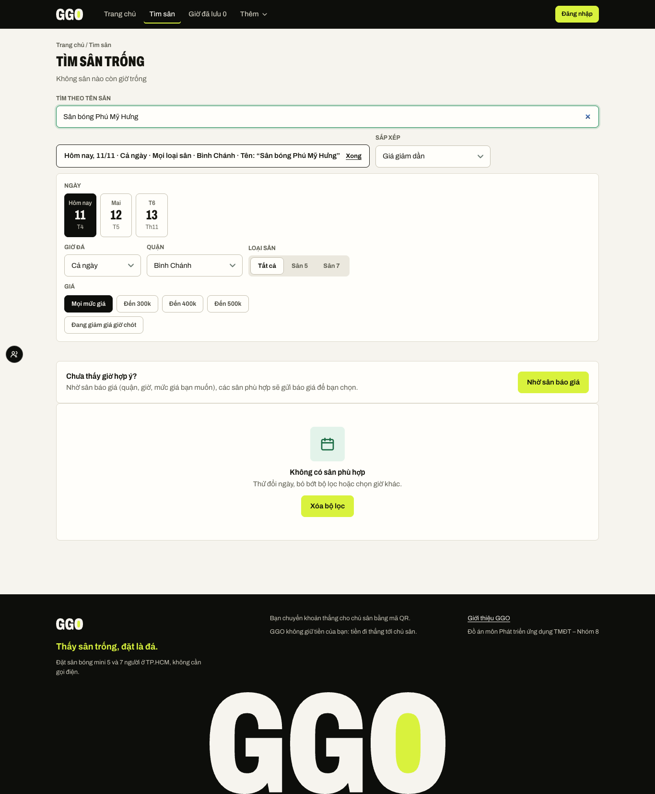
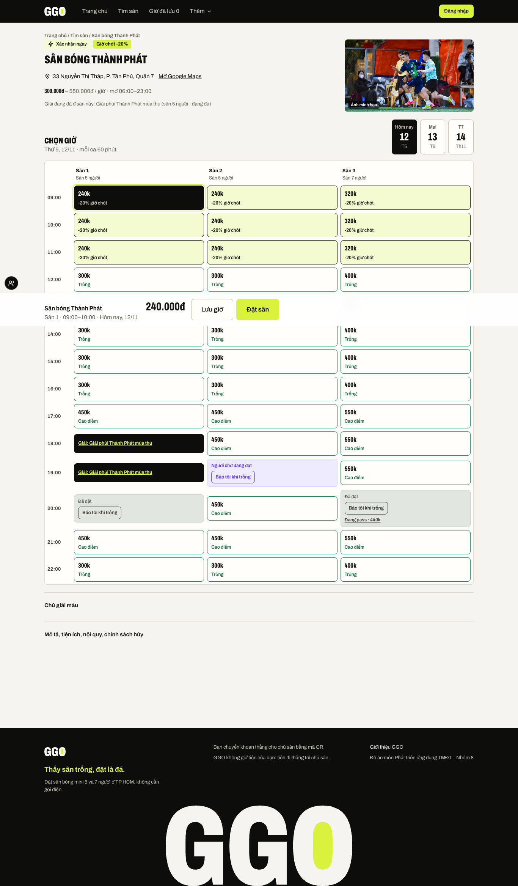
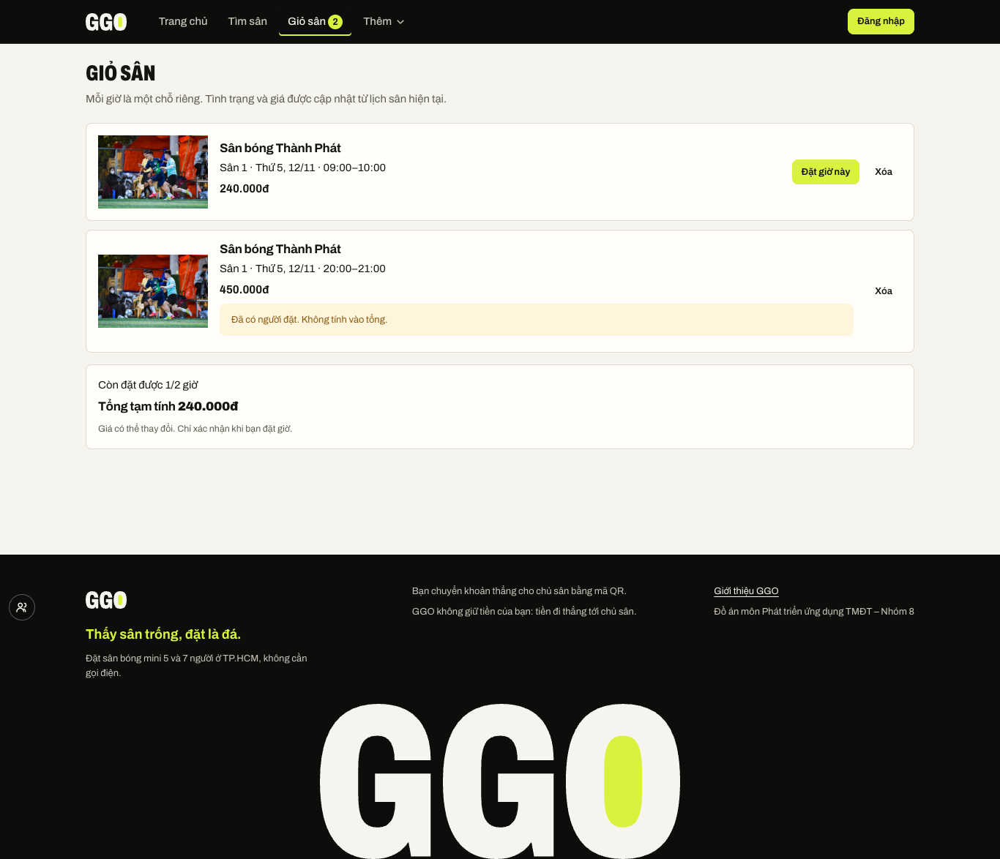
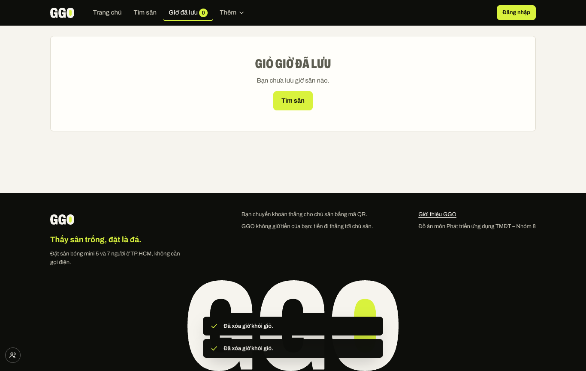

# Báo cáo Buổi 3 – Tích hợp JavaScript cho GGO

**Nhóm 8 · Môn Phát triển ứng dụng Thương mại điện tử**

## Mục lục

1. Bước 1 – Chuẩn bị và thống nhất phạm vi
2. Bước 2 – Dữ liệu và danh sách sân
3. Bước 3 – Tìm kiếm, lọc và sắp xếp
4. Bước 4 – Trang chi tiết sân
5. Bước 5 – Giỏ sân
6. Bước 6 – Lưu và khôi phục dữ liệu
7. Bước 7 – Tích hợp, kiểm thử và giao diện
8. Bước 8 – Hoàn thiện, GitHub và sử dụng AI
9. Câu hỏi kiểm tra kiến thức

## Bước 1. Chuẩn bị và thống nhất phạm vi

Nhóm tiếp tục phát triển website GGO đã thực hiện ở các buổi trước, kế thừa giao diện và luồng đặt sân. Với đặc thù dịch vụ, nhóm xem sân và khung giờ là đối tượng cần tìm, còn quận và loại sân 5/7 người là nhóm phân loại. Nhóm thống nhất tìm theo tên sân và sắp xếp theo giá tăng hoặc giảm.

Giỏ sân là danh sách những khung giờ khách muốn xem lại hoặc đặt riêng. Mỗi dòng biểu thị một sân con, ngày và giờ cụ thể; cùng một lựa chọn không tạo thêm dòng trùng. Giỏ sân không giữ chỗ và không xác nhận đặt sân. Khi khách tiếp tục đặt, tình trạng và giá được kiểm tra lại theo luồng đặt sân của website.


## Bước 2. Dữ liệu và trang danh sách sân

Danh sách sân được hiển thị từ nguồn dữ liệu thống nhất của website, gồm thông tin tên, khu vực, mức giá, loại sân và giờ còn có thể đặt. Thiết kế kế thừa bố cục trang danh sách hiện tại, giúp người dùng nhận biết các sân và những thông tin cần thiết trước khi xem chi tiết. Dữ liệu trình bày trong môi trường minh họa không được xem là xác nhận về tình trạng sân ngoài thực tế.

## Bước 3. Tìm kiếm, lọc và sắp xếp

Người dùng có thể nhập tên sân và chọn thứ tự giá mà không cần mở phần bộ lọc. Các tiêu chí về quận, loại sân, mức giá và thời điểm được kết hợp để thu hẹp kết quả. Khi không có sân phù hợp, trang thông báo rõ trạng thái rỗng; lựa chọn tìm kiếm và bộ lọc được giữ lại khi tải lại trang.




## Bước 4. Trang chi tiết sân

Trang chi tiết trình bày địa điểm, mức giá và lịch chọn giờ. Khách chọn ngày, sân con và giờ phù hợp rồi mới tiếp tục đặt. Nếu sân không tồn tại hoặc giờ đã được người khác đặt, giao diện cho biết tình trạng và cho phép khách quay lại tìm lựa chọn khác. Nút thêm giờ vào giỏ sân được tách biệt với thao tác đặt sân để tránh nhầm lẫn giữa lưu lựa chọn và xác nhận đặt.




## Bước 5. Giỏ sân

Giỏ sân hiển thị từng lựa chọn theo sân, ngày, giờ bắt đầu và sân con. Khách có thể bỏ lựa chọn hoặc quay lại đúng khung giờ để tiếp tục đặt. Trang làm rõ rằng một dòng tương ứng một giờ, không có cơ chế tăng số lượng cho cùng một chỗ và việc lưu lựa chọn không bảo đảm giờ vẫn còn trống.

Khi mở giỏ sân, website đối chiếu lại lịch và giá hiện tại. Giờ đã bị đặt, đang giữ hoặc không còn khả dụng được cảnh báo và không cộng vào tổng tạm tính. Tổng tiền chỉ có ý nghĩa tham khảo cho các giờ còn trống; bước đặt sân vẫn phải xác nhận lại.







## Bước 6. Lưu và khôi phục dữ liệu

Danh sách trong giỏ sân được lưu bằng `localStorage` trên trình duyệt đang sử dụng, để vẫn còn sau khi chuyển trang hoặc tải lại. Website chỉ lưu thông tin nhận diện sân, sân con, ngày và giờ; khi hiển thị lại, lịch và giá được tải mới thay vì tin vào thông tin cũ. `saveCart` và `loadCart` đảm nhiệm việc lưu, đọc và kiểm tra dữ liệu; dữ liệu sai định dạng được loại bỏ an toàn.

Khi khách thay đổi giỏ sân ở một thẻ trình duyệt khác, số lượng trên menu được cập nhật để phản ánh trạng thái mới. Việc lưu trên một trình duyệt không tạo giữ chỗ và không đồng bộ thành đơn đặt sân.

## Bước 7. Tích hợp, kiểm thử và giao diện

Các luồng tìm kiếm, lọc, sắp xếp, xem chi tiết, thêm/bỏ lựa chọn, tải lại dữ liệu và trạng thái trống được kiểm tra trên màn hình điện thoại và máy tính. Kết quả được đối chiếu với hành vi mong đợi; các trường hợp lưu lặp, giờ đã có người đặt và cập nhật giữa các thẻ đều được kiểm tra. Bộ kiểm thử tích hợp của dự án và kiểm thử riêng cho giỏ sân đều đạt. Trong các luồng trình duyệt đã kiểm tra, không ghi nhận lỗi JavaScript hoặc lỗi trang.

**Bảng 7.1. Tổng hợp kiểm thử chức năng**

| Mã TC | Trường hợp kiểm thử | Kết quả |
|---|---|---|
| TC01 | Mở danh sách sân | Tìm kiếm và sắp xếp dùng được ngay; đạt trên điện thoại và máy tính. |
| TC02 | Tải danh sách | Có sân để thao tác; đạt. |
| TC03 | Tìm tên sân phù hợp | Chỉ hiện các sân khớp; đạt. |
| TC04 | Tìm từ khóa không tồn tại | Báo không có kết quả; đạt. |
| TC05 | Xem trạng thái không có kết quả | Giữ lại từ khóa tìm; đạt. |
| TC06 | Chọn quận và giá tăng | Giá theo thứ tự tăng; đạt. |
| TC07 | Chọn giá giảm | Giá theo thứ tự giảm; đạt. |
| TC08 | Kết hợp quận, tên và thứ tự giá | Tiêu chí được giữ trong đường dẫn; đạt. |
| TC09 | Tải lại trang đã lọc | Khôi phục lựa chọn; đạt. |
| TC10 | Thêm một giờ còn trống | Có một dòng trong giỏ sân; đạt. |
| TC11 | Thêm lại cùng giờ | Không tạo dòng trùng; đạt. |
| TC12 | Thay đổi giỏ ở thẻ khác | Số hiển thị được cập nhật; đạt. |
| TC13 | Mở giỏ sân | Tải lại lịch và giá hiện tại; đạt. |
| TC14 | Giờ đã bị chiếm | Cảnh báo và không tính vào tổng; đạt. |
| TC15 | Tiếp tục đặt một giờ | Trở lại đúng sân, ngày, giờ và sân con; đạt. |
| TC16 | Bỏ hết lựa chọn | Hiện trạng thái trống và số lượng bằng không; đạt. |
| TC17 | Thêm lặp cùng một giờ | Chỉ giữ một lựa chọn; đạt. |
| TC18 | Bỏ một lựa chọn và tính tổng | Tổng phản ánh các giờ còn trống; đạt. |
| TC19 | Dữ liệu lưu lỗi hoặc không hợp lệ | Khôi phục an toàn, không hiển thị dòng sai; đạt. |
| TC20 | Theo dõi lỗi trong luồng giỏ sân | Không phát sinh lỗi trang; đạt. |

**Bảng 7.2. Nhật ký lỗi đã khắc phục**

| Triệu chứng | Nguyên nhân | Cách khắc phục |
|---|---|---|
| Không thấy ô tìm và lựa chọn thứ tự giá | Các điều khiển bị đặt trong vùng lọc thu gọn | Đưa chúng ra khu vực luôn hiển thị trên danh sách sân. |
| Điều khiển bị chật trên điện thoại | Các thành phần vẫn xếp ngang ở màn hình hẹp | Chuyển sang bố cục dọc và dùng đủ chiều rộng. |
| Sân hết giờ chen vào thứ tự sân còn giờ | Hai nhóm trạng thái được sắp xếp chung | Sắp xếp riêng nhóm còn giờ và nhóm hết giờ. |
| Bộ lọc quận không được khôi phục đúng trong kiểm thử | Lựa chọn quận không có giá trị thuộc tính riêng | Chọn theo nhãn quận và xác nhận lại trạng thái sau tải lại. |
| Nội dung giỏ dễ bị hiểu như xác nhận đặt sân | Cách gọi trước đây gần với giỏ hàng mua sản phẩm | Dùng tên “Giỏ sân” và nêu rõ lựa chọn chưa giữ chỗ. |
| Giá hoặc tình trạng giờ trong giỏ sân bị cũ | Lịch có thể thay đổi sau khi khách rời trang | Tải lại lịch và giá; cảnh báo giờ không còn khả dụng. |
| Số hiển thị trên menu bị cũ ở thẻ khác | Mỗi thẻ trình duyệt có giao diện riêng | Đồng bộ thay đổi giữa các thẻ đang mở. |

### Giới hạn kiểm thử

Các ảnh và luồng minh chứng sử dụng dữ liệu trình diễn trong trình duyệt. Kết quả không thay thế việc xác nhận trực tiếp lịch của sân, kiểm tra môi trường vận hành thật hoặc thanh toán ngân hàng. Kiểm thử bao phủ các trường hợp được liệt kê, không chứng minh mọi tổ hợp bộ lọc hay mọi tình huống nhiều người cùng đặt đồng thời. Nhóm không đưa ra kết luận về trải nghiệm người dùng nếu chưa có thử nghiệm người dùng thực tế.

## Bước 8. Hoàn thiện, GitHub và sử dụng AI

Nhóm duy trì mã nguồn chung và ghi nhận thay đổi theo từng phần chức năng. README được cập nhật để hướng dẫn cách hiểu sản phẩm, cách chạy và cách kiểm thử. Báo cáo và ảnh chụp tổng hợp các phần đã triển khai; lịch sử đóng góp được mô tả theo bằng chứng hiện có, không quy kết hoạt động riêng khi chưa xác minh được.

**Sử dụng AI.** Công cụ AI hỗ trợ phân tích yêu cầu, đề xuất cách triển khai, viết và rà soát kiểm thử, cũng như biên tập tài liệu. Nhóm đối chiếu đề xuất với yêu cầu và kiểm tra hành vi bằng kiểm thử, giao diện và ảnh chụp. AI không được xem là nguồn xác nhận thay cho kết quả thực tế; giới hạn của dữ liệu và luồng đã kiểm tra được nêu riêng.

## Câu hỏi kiểm tra kiến thức

1. **Nhóm tổ chức dữ liệu sản phẩm như thế nào để các trang cùng sử dụng? (GGO: sân và giờ)** GGO dùng cùng nguồn thông tin sân và lịch khi người dùng tìm kiếm, mở chi tiết và xem giỏ sân. Trên trang danh sách, website lấy sân theo điều kiện đang chọn; khi mở chi tiết, website lấy lại thông tin sân và lịch của ngày tương ứng. Khi thêm một giờ, giỏ chỉ lưu mã sân, mã sân con, ngày và giờ bắt đầu, không sao chép giá hay trạng thái còn chỗ.

   Ví dụ, khách lưu giờ 20:00 ở Sân 1 rồi sang giỏ sân, trang giỏ tải lại lịch và giá hiện tại. Nếu giờ đã bị đặt trong lúc khách rời trang, giỏ hiển thị cảnh báo và không cộng giờ ấy vào tổng. Cách này tránh xem dữ liệu cũ là xác nhận còn chỗ; giỏ sân chỉ ghi nhớ lựa chọn, không thay thế bước đặt sân.

2. **Khi người dùng tìm kiếm và lọc sản phẩm đồng thời, nhóm xử lý dữ liệu theo trình tự nào? (GGO: tìm sân)** Khi mở danh sách, GGO đọc từ khóa, ngày, giờ, quận, loại sân, mức giá, giờ chót và thứ tự giá từ đường dẫn bằng `URLSearchParams`. Từ khóa, ngày, quận, loại sân và mức giá được gửi cùng yêu cầu lấy danh sách; sau đó, giờ cụ thể và giờ chót được áp dụng để lọc các khung giờ. Cuối cùng, danh sách được sắp theo giá trong hai nhóm riêng: sân còn giờ và sân không còn giờ.

   Chẳng hạn, khách chọn một quận, nhập tên sân rồi chọn giá tăng; khi tải lại, các lựa chọn vẫn hiện và thứ tự giá được giữ. Việc ghi trạng thái vào đường dẫn giúp khôi phục lựa chọn, còn tách hai nhóm giờ giúp sân không còn chỗ không chen vào giữa các sân có thể đặt.

3. **Làm thế nào để trang chi tiết xác định đúng sản phẩm từ URL? (GGO: sân và giờ)** Khi người dùng mở trang, `URLSearchParams` đọc mã sân cùng ngày, giờ và sân con từ đường dẫn. Trang lấy thông tin sân và lịch; nếu đường dẫn có giờ cụ thể, trang chỉ chọn sẵn giờ đó khi giờ vẫn đặt được. Ngày ngoài thời hạn đặt được đưa về ngày hợp lệ; mã sân không tồn tại dẫn tới thông báo không tìm thấy sân.

   Ví dụ, từ danh sách khách mở Sân 1 lúc 20:00 thì trang chi tiết hiển thị đúng sân và ngày đã chọn. Nếu người khác vừa đặt giờ đó, trang báo tình trạng và yêu cầu chọn giờ khác thay vì gửi yêu cầu đặt cho lựa chọn đã lỗi thời. Cách kiểm tra này gắn thao tác đặt với đúng sân và giờ.

4. **Khi thêm một sản phẩm đã có trong giỏ hàng, hàm xử lý như thế nào? (GGO: sân và giờ)** GGO so sánh bốn thông tin: sân, sân con, ngày và giờ bắt đầu. Nếu đã có dòng trùng đủ bốn thông tin, thao tác thêm trả về kết quả không thành công; trang chi tiết hiện thông báo “Giờ này đã có trong giỏ sân.” Nếu khác ngày hoặc sân con, đó là một lựa chọn riêng.

   Ví dụ, thêm Sân 1 lúc 20:00 vào cùng ngày lần đầu sẽ tạo một dòng; bấm “Thêm vào giỏ sân” lần nữa cho đúng giờ ấy chỉ hiện thông báo trùng, không tăng số lượng. Mỗi sân con trong một khung giờ là một chỗ, nên ngăn lưu trùng giúp người dùng không hiểu nhầm rằng mình có thể giữ nhiều bản sao cùng chỗ.

   ```js
   const rows = read();
   if (rows.some((r) => same(r, item))) return false;
   saveCart([...rows, { venueId: Number(item.venueId), courtId: Number(item.courtId), date: item.date, start: item.start }]);
   return true;
   ```

5. **Những thành phần nào cần được cập nhật khi số lượng sản phẩm thay đổi? (GGO: lựa chọn giờ và giỏ sân)** GGO không có số lượng nhiều bản sao cho một giờ: thêm hoặc xóa là thay đổi số dòng lựa chọn. Khi lưu hoặc bỏ giờ, badge trên menu cập nhật; trong cùng thẻ, sự kiện giao diện làm mới badge, còn thẻ khác nhận thay đổi qua sự kiện lưu trữ. Trang giỏ đọc lại các dòng, tải lại tình trạng và giá, cập nhật cảnh báo, số giờ còn đặt được và tổng tạm tính.

   Ví dụ, nếu có hai giờ trong giỏ nhưng một giờ đã bị người khác đặt, trang vẫn cho thấy hai lựa chọn đã lưu, ghi “Còn đặt được 1/2 giờ” và chỉ cộng giá của giờ còn trống. Vì trạng thái có thể đổi sau khi lưu, tổng chỉ là tham khảo và giỏ không bảo đảm khách sẽ đặt được giờ đó; việc đặt vẫn phải kiểm tra lại lịch.

6. **Vì sao cần lưu giỏ hàng bằng localStorage? Dữ liệu được khôi phục như thế nào? (GGO: giỏ sân)** GGO dùng `localStorage` với khóa giỏ `ggo.cart` để lựa chọn còn lại khi khách chuyển trang hoặc tải lại cùng website trên trình duyệt đó. `loadCart` đọc và kiểm tra dữ liệu; `saveCart` ghi danh sách sau khi thêm hoặc xóa, phát thông báo cập nhật giao diện và đọc lại kết quả. Cả thao tác đọc lẫn ghi đều được bảo vệ để lỗi định dạng hoặc việc trình duyệt không cho truy cập bộ nhớ không làm hỏng trang.

   Ví dụ, sau khi tải lại, mã sân, sân con, ngày và giờ được khôi phục; trang giỏ tiếp tục tải lịch và giá mới. Dữ liệu chỉ nằm trong trình duyệt đó, không đồng bộ giữa thiết bị, không khóa giờ và không tạo đơn đặt. Đó là lý do bước đặt sân phải kiểm tra tình trạng hiện tại trên máy chủ.

   ```js
   const raw = storage.getItem(KEY);
   const rows = raw ? JSON.parse(raw) : [];
   if (!Array.isArray(rows)) return [];
   ```

7. **Nếu giỏ hàng hiển thị đúng ở một trang nhưng sai ở trang khác, nhóm sẽ kiểm tra những phần nào? (GGO: giỏ sân)** Trước hết cần xác nhận mọi trang dùng cùng khóa `ggo.cart`, cùng module giỏ và cùng khung menu; badge phải lấy số dòng qua `countCart`, vốn dùng chung hàm đọc dữ liệu, chứ không tự tính từ một nguồn khác. Tiếp theo kiểm tra thao tác lưu có phát sự kiện cập nhật trong cùng trang hay không, và thẻ khác có nghe sự kiện `storage` đúng khóa hay không. Khi đọc, dữ liệu cũ hoặc sai cấu trúc cũng phải được lọc nhất quán.

   Chẳng hạn, nếu xóa một giờ ở trang giỏ trong thẻ thứ hai, badge trên trang danh sách ở thẻ thứ nhất phải giảm ngay. Nếu chưa giảm, nhóm kiểm tra listener hai thẻ và khóa sự kiện; sau đó mở DevTools → Application → Local Storage, xem `ggo.cart` đã thay đổi chưa. Cũng cần xác nhận trang danh sách, trang chi tiết và trang giỏ cùng nạp module giỏ/khung menu; lệch một trong các điểm này có thể khiến một trang hiển thị dữ liệu cũ.

8. **Nhóm đã xử lý xung đột mã nguồn và tích hợp các phần việc bằng GitHub như thế nào?** Nhóm tách công việc tìm kiếm/sắp xếp, giỏ sân và tài liệu thành các nhánh riêng; mỗi phần được rà soát, kiểm tra rồi mới gộp vào nhánh chính. Khi gộp tìm kiếm/sắp xếp với giỏ, cả hai nhánh cùng thêm luồng kiểm thử vào danh sách chạy chung nên phát sinh xung đột; nhóm giải quyết bằng cách giữ lại cả hai luồng.

   Nhánh giỏ đã được công khai trên GitHub trước khi nhập vào nhánh chính, vì vậy nhóm dùng merge thay vì rebase để giữ lịch sử đã chia sẻ. Cách làm này vừa bảo toàn phần kiểm thử của hai chức năng, vừa thể hiện được tiến trình phát triển độc lập trước khi tích hợp.

9. **Khi AI đề xuất một đoạn mã, nhóm kiểm tra và xác nhận mã hoạt động đúng bằng cách nào?** Nhóm chạy bộ kiểm thử dự án đạt 183/183; kiểm thử trình duyệt cho tìm kiếm/sắp xếp và giỏ sân đều đạt ở độ rộng 390 và 1366. Nhóm còn xem ảnh giao diện thay vì chỉ dựa vào kết quả tự động. Qua đó phát hiện ô tìm bị ẩn trong vùng lọc thu gọn, nhãn sắp xếp bị cắt trên điện thoại và sân hết giờ bị xếp xen vào nhóm sân còn giờ; các điểm này được điều chỉnh rồi kiểm tra lại.

   Ảnh giỏ sân cho thấy dấu câu sau lý do giờ không khả dụng bị thiếu, câu “1 giờ còn trống · 1 giờ” khó hiểu và ngày hiển thị dài hơn cần thiết; nhóm sửa dấu câu, ghi số giờ còn đặt được trên tổng và rút gọn nhãn ngày. Một kiểm thử sau khi tải lại trang cũng lấy thuộc tính `value` trực tiếp từ lựa chọn quận, trong khi lựa chọn không khai báo thuộc tính này; nhóm sửa kiểm thử để chọn theo nội dung nhãn. Việc chạy kiểm thử và xem giao diện giúp phát hiện cả lỗi hành vi lẫn cách diễn đạt khó hiểu.

10. **Nếu cần bổ sung một chức năng mới, nhóm sẽ xác định những thành phần nào cần chỉnh sửa?** Trước khi sửa, nhóm lần theo yêu cầu từ dữ liệu và trạng thái dùng chung đến trang hiển thị, điều khiển kích hoạt chức năng, điều hướng, cách phục vụ trang, kiểm thử và hướng dẫn. Với giỏ sân, nhóm bổ sung module dữ liệu giỏ, trang `cart.html` cùng CSS riêng; nối nút thêm ở trang chi tiết với thao tác lưu; cập nhật menu, badge và đồng bộ giữa các thẻ. Nhóm cũng kiểm tra việc phục vụ trang tĩnh, sơ đồ trang, kiểm thử đơn vị, E2E và README.

   Đối chiếu thống kê thay đổi của các phần giỏ cho thấy đây là các vùng thực sự được thêm hoặc sửa; `cart.html` được phục vụ nhờ cơ chế quét trang sẵn có nên không phải sửa danh sách. Sơ đồ trang là thành phần cần xem xét khi thêm trang mới, nhưng giỏ sân lưu lựa chọn riêng trên trình duyệt của từng người nên không đưa vào sơ đồ. Giỏ chỉ lưu lựa chọn, không gọi luồng tạo booking, không đặt giữ chỗ 15 phút và không xử lý chuyển khoản; cố ý giữ nguyên các quy tắc nghiệp vụ này giúp chức năng mới không làm thay đổi cách đặt sân.
