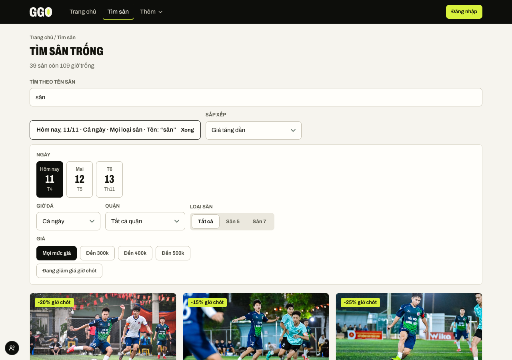
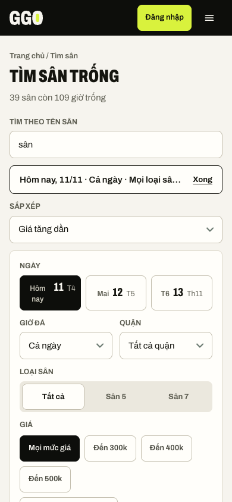
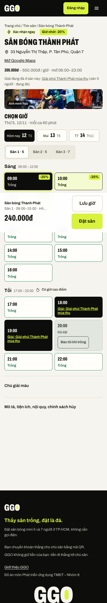
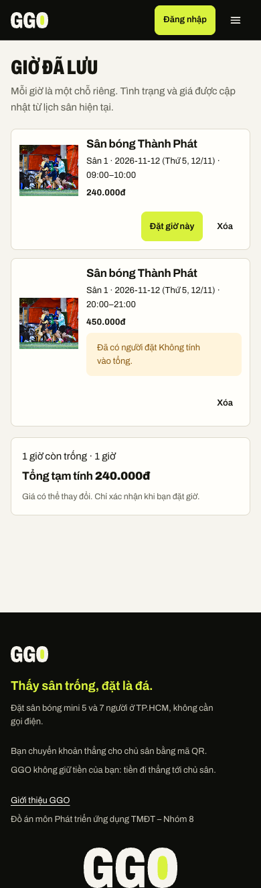
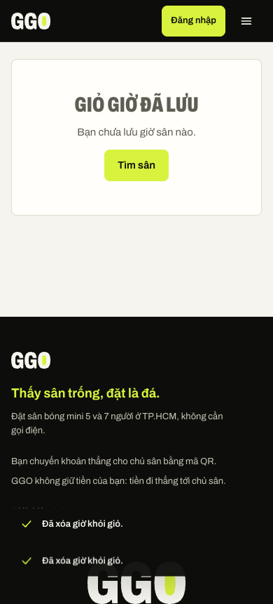
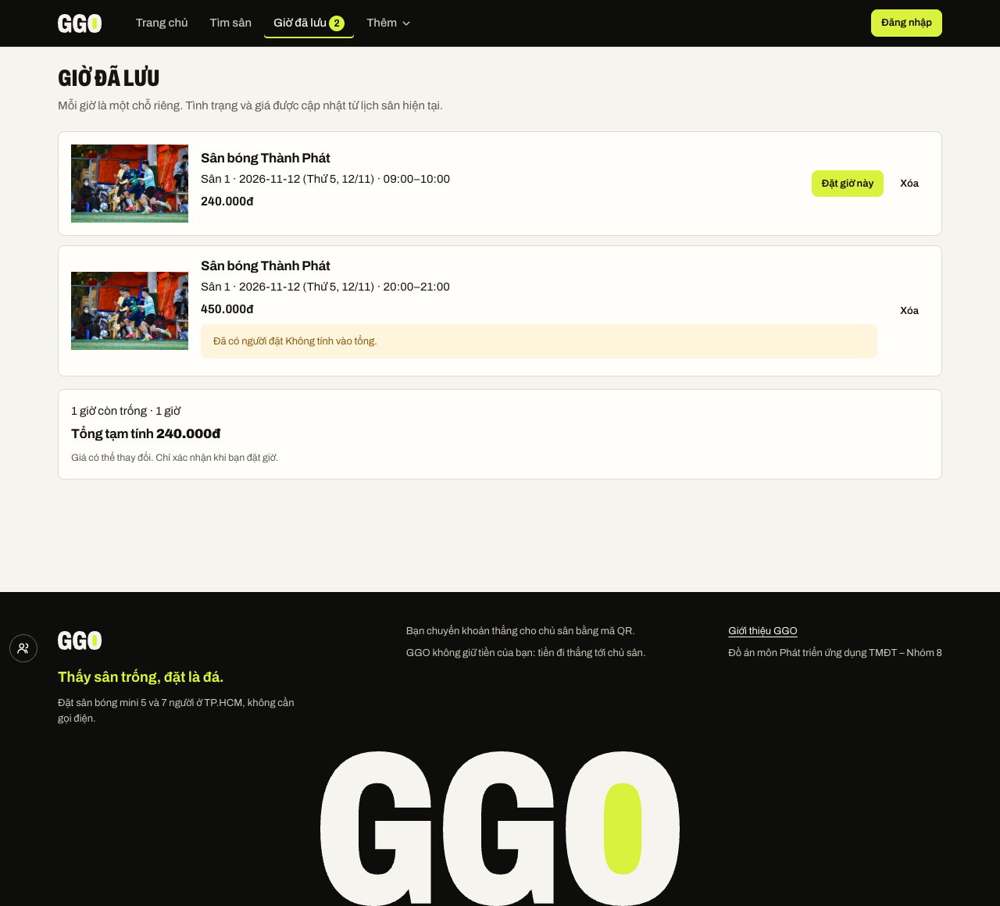

# Báo cáo Buổi 3 – Tích hợp JavaScript cho GGO

**Nhóm 8 · GGO – Website đặt sân bóng đá mini tại TP.HCM**  
Môn Phát triển ứng dụng Thương mại điện tử

## Mục lục

1. Bước 1 – Chuẩn bị và thống nhất phạm vi
2. Bước 2 – Dữ liệu và trang danh sách sân
3. Bước 3 – Tìm kiếm, lọc và sắp xếp
4. Bước 4 – Chi tiết sân
5. Bước 5 – Giỏ giờ đã lưu
6. Bước 6 – Lưu và khôi phục bằng localStorage
7. Bước 7 – Tích hợp, kiểm thử và giao diện
8. Bước 8 – GitHub, README, AI và trình bày
9. Câu hỏi kiểm tra kiến thức

## I. Bước 1 – Chuẩn bị và thống nhất phạm vi

Nhóm kế thừa GGO từ Buổi 1–2, không dựng lại website. Đề dùng ví dụ sản phẩm bán lẻ; với GGO, nhóm thống nhất “sản phẩm” là sân/khung giờ có thể đặt, “danh mục” là quận và loại sân 5/7 người. Dữ liệu thật đi qua API, prototype/Pages dùng dữ liệu mock.

Nhóm chốt tìm theo tên và sắp xếp giá tăng/giảm. Giỏ là danh sách các giờ cụ thể đã lưu; mỗi dòng là đúng một sân con, ngày và giờ. Không có nút `+`/`−`: cùng một khung giờ là một chỗ vật lý, không thể mua số lượng hai lần. Giỏ chỉ ghi nhớ lựa chọn, không giữ chỗ; khi khách đặt, hệ thống dùng luồng booking hiện tại và kiểm tra lại tình trạng/giá.

README giữ bảng phân công vai trò của nhóm như đã có, không gán công việc cá nhân mới trong báo cáo này.

## II. Bước 2 – Dữ liệu và trang danh sách sân

`mock/venues.json` có 40 cụm sân; danh sách thực tế được lấy qua `api.venues()` từ `js/api.js`, không tạo bản sao `products.js`. Các bản ghi sân có mã, tên, khu vực, giá, ảnh, mô tả, sân con và giờ. Giao diện danh sách trong `products.html` do `js/venues.js` tạo từ kết quả API; thẻ hiện ảnh, tên, khu vực, loại sân, giá và các giờ còn trống.

Trang tiếp tục dùng CSS chung và bố cục hiện có. Bài nộp diễn giải mẫu “ít nhất 8 sản phẩm” thành 8 sân trở lên; dữ liệu mock hiện có 40 cụm sân. Không coi 40 sân mock là dữ liệu backend production.

## III. Bước 3 – Tìm kiếm, lọc và sắp xếp

Trang `products.html` có ô **Tìm theo tên sân** và điều khiển **Sắp xếp** ngoài bộ lọc đang thu gọn. `js/venues.js` lưu trạng thái trên URL (`q`, `sort` và các bộ lọc khác), tìm theo tên qua `api.venues`, lọc quận/loại sân 5/7, giá và thời điểm; kết quả cập nhật sau thao tác. Sort giá dùng `minPrice`, khi bằng nhau dùng tên tiếng Việt; hai nhóm sân còn giờ và không còn giờ được sort riêng, để sân hết giờ không xen vào thứ tự giờ có thể đặt. Mặc định giữ thứ tự ưu tiên giờ có thể đặt.

## IV. Bước 4 – Chi tiết sân

`product-detail.html` dùng một trang chi tiết động. `js/venue.js` đọc `id`, `date`, `slot`, `court` từ URL, lấy venue/lịch hiện tại qua API và hiển thị thông tin sân, giá, lịch. Nếu ID không tồn tại, trang báo không tìm thấy và có đường quay lại danh sách. Chọn giờ đi tới flow đặt sân hiện có; nếu slot đã bị người khác lấy, API trả xung đột và lịch được tải lại.

## V. Bước 5 – Giỏ giờ đã lưu

`cart.html` trình bày các giờ đã lưu. Mỗi dòng định danh bằng `venueId`, `courtId`, `date`, `start`; thêm lặp cùng slot không tạo dòng thứ hai. Khách có thể bỏ dòng hoặc trở lại chi tiết để đặt riêng. Giỏ không phải đơn mua nhiều slot, không có nút tăng/giảm số lượng và không đảm bảo còn chỗ.

Trang giỏ gọi lại API để lấy tên, lịch, tình trạng và giá hiện thời; slot đã đặt/giữ/qua hạn được cảnh báo và không cộng vào tổng tạm tính. Nếu một giờ còn trống, link “Đặt giờ này” quay lại đúng venue/ngày/giờ/sân con. Tổng là tổng giá các giờ còn trống, chỉ tham khảo đến khi khách tạo booking.

## VI. Bước 6 – Lưu và khôi phục bằng localStorage

`js/cart.js` dùng khóa `ggo.cart`. Chỉ lưu các trường định danh slot, không lưu giá có thẩm quyền hay trạng thái chỗ. `loadCart()` xử lý khóa trống, JSON lỗi, dữ liệu không phải mảng và loại các dòng không hợp lệ; `saveCart()` cập nhật localStorage và phát sự kiện để cập nhật badge. Trang giỏ tải lại schedule/venue để hiện tình trạng/giá mới. Badge nhận cập nhật cả trong tab khác qua sự kiện `storage`.

Mở DevTools → Application → Local Storage → origin prototype để xem khóa `ggo.cart`. Khi sửa nội dung key thủ công, tải lại `/cart` để kiểm tra việc bỏ dữ liệu sai; không dùng key này làm căn cứ giữ sân hoặc tạo booking.

## VII. Bước 7 – Tích hợp, kiểm thử và giao diện

### 7.1. Kiểm thử chức năng

Tìm kiếm/sắp xếp: `e2e/b3-search.mjs` chạy ở 390 và 1280 px, mỗi lần 10 assertion đạt. Giỏ: kết quả lưu trong `e2e/out/results-b3-cart-{390,1280,1366}.json`; 7/7, 6/6, 7/7 bước đạt, log Console/page error rỗng. Ở 1280 px bài không có bước sync hai tab; bước này chạy đạt ở 390 và 1366. `node --test tests/cart.test.js`: 3/3 test đạt.

| ID | Chức năng / dữ liệu vào | Kết quả mong đợi | Kết quả thực tế |
|---|---|---|---|
| TC01 | Mở danh sách ở 390/1280 | Ô tìm, sort hiện khi chưa mở bộ lọc | Đạt ở cả hai khổ |
| TC02 | Đợi tải danh sách sân | Có thẻ venue để thao tác | Đạt; query “sân” trả 39 sân trong ảnh kiểm thử |
| TC03 | Tìm tên sân khớp | Mọi thẻ kết quả chứa tên đã nhập | Đạt ở 390 và 1280 |
| TC04 | Tìm chuỗi không tồn tại | Hiện thông báo không có kết quả | Đạt ở 390 và 1280 |
| TC05 | Không có kết quả | Dòng tóm tắt giữ lại query tìm | Đạt ở 390 và 1280 |
| TC06 | Chọn quận + giá tăng | Giá tối thiểu theo thứ tự tăng | Đạt ở 390 và 1280 |
| TC07 | Đổi sang giá giảm | Giá tối thiểu theo thứ tự giảm | Đạt ở 390 và 1280 |
| TC08 | Kết hợp quận, query và sort | URL lưu đúng bộ lọc | Đạt: `district`, `q` được ghi vào URL |
| TC09 | Reload trang có query/sort/quận | Ô nhập/select khôi phục giá trị | Đạt ở 390 và 1280 |
| TC10 | Từ chi tiết lưu giờ trống | Giỏ có một dòng, badge = 1 | Đạt; test E2E giỏ 390/1280/1366 |
| TC11 | Lưu cùng slot lần nữa | Không tạo dòng trùng, báo đã có | Đạt ở 390/1280/1366 |
| TC12 | Đổi giỏ từ tab khác | Badge tab đang mở đồng bộ | Đạt ở 390 và 1366; không chạy ở 1280 |
| TC13 | Mở giỏ sau khi lưu | Schedule và giá được tải mới | Đạt; hiển thị giá hiện tại 240.000đ trong fixture |
| TC14 | Giỏ có slot đã bị chiếm | Có cảnh báo, slot bị loại khỏi tổng | Đạt; fixture slot đã đặt không tính vào tổng |
| TC15 | Bấm “Đặt giờ này” | Trở về đúng venue/date/slot/court | Đạt; URL khớp slot đã chọn |
| TC16 | Xóa đến khi hết dòng | Empty state, badge bằng 0 | Đạt ở 390/1280/1366 |
| TC17 | Unit: add một slot rồi add trùng | Một row, `addCart` lần 2 trả false | Đạt |
| TC18 | Unit: xóa một trong hai giờ và tính tổng | Còn đúng giờ kia; tổng đúng giá | Đạt; hai giá 120.000 + 95.000 cho tổng 215.000đ |
| TC19 | Unit: key hỏng/null/dòng không hợp lệ | Trả giỏ rỗng hoặc chỉ giữ row hợp lệ | Đạt |
| TC20 | Browser logs trong luồng giỏ | Không có console/page errors | Đạt; logs rỗng ở 390/1280/1366 |

### 7.2. Giao diện

Ảnh minh chứng được chụp bằng Chrome/Playwright với dữ liệu mock. Có ảnh tìm/sort ở 390, 1280 và giỏ/chi tiết/rỗng ở 390, 1280. Ảnh được kiểm bằng mắt để xác nhận điều khiển không bị ẩn, card/giá/trạng thái đọc được và empty state xuất hiện; số đo tràn ngang độc lập chưa được lập cho các trang Buổi 3, nên không khẳng định đã đo toàn bộ breakpoint.

### 7.3. Nhật ký lỗi đã sửa

| Triệu chứng | Nguyên nhân | Cách sửa / kết quả |
|---|---|---|
| Ô tìm và sort không thấy nếu chưa bấm “Đổi” | Cả hai nằm trong form `#filters` có `hidden` mặc định | Đưa ra ngoài vùng lọc thu gọn; kiểm tra visible ngay khi mở danh sách. |
| Nhãn/select sort bị chật ở 390 px | Thanh tóm tắt giữ các điều khiển ngang ở màn hẹp | CSS dưới 480 px xếp dọc, select dùng đủ chiều rộng; chụp và test màn điện thoại. |
| Sân hết giờ xen giữa sân còn giờ khi sort | Ghép hai nhóm rồi sort chung | Sort `withSlots` và `without` tách biệt; sân hết giờ không chen vào nhóm sân đặt được. |
| E2E F5 đọc sai quận | `<option>` quận không có `value`; test cũ dùng `getAttribute('value')` | Dùng text option để chọn quận, assert dữ liệu đã lưu bằng giá trị control; test query/sort/filter sau reload. |
| Chữ giỏ khiến người dùng hiểu là quantity/đặt xong | Giỏ sản phẩm thường không khớp domain đặt sân, giá/chỗ có thể đổi | Dùng “Giờ đã lưu”, nói rõ mỗi dòng là chỗ riêng, giá mới nhất/tạm tính và không giữ giờ; bỏ nút `+`/`−`. |
| Giờ đã lưu có thể stale sau khi chuyển trang | Tình trạng/giá biến động do người khác đặt | Chỉ lưu định danh slot; hydrate lại sân/lịch từ API, cảnh báo và loại khỏi total nếu slot không khả dụng. |
| Badge có thể cũ ở tab còn mở | Mỗi tab có bộ nhớ giao diện riêng | Phát custom event trong tab và nghe `storage` giữa các tab; E2E đồng bộ badge đạt ở hai kích thước. |

### 7.4. Giới hạn kiểm thử

Kiểm thử dùng prototype/mock và trình duyệt cục bộ; không thay thế kiểm tra backend MySQL production hoặc thanh toán/ngân hàng thật. Test browser chỉ bao phủ những flow ghi trong bài E2E, không chứng minh mọi tổ hợp filter hoặc mọi cạnh tranh đặt cùng lúc. Cart E2E artifacts có 390/1280/1366; search E2E thực chạy ở 390/1280. Chưa tuyên bố trải nghiệm tốt hơn qua thử nghiệm người dùng thật.

## VIII. Bước 8 – GitHub, README, AI và trình bày

Nhóm làm việc trên repo chung, tính năng được tách commit có nội dung rõ; lịch sử cho thấy phần tìm/sort, test và cart có các commit riêng. Tất cả thay đổi phần này được agent commit dưới danh tính Đạt noreply theo phân công điều phối; không ghi nhận là tám thành viên tự commit. README tóm tắt mục tiêu, trang, công nghệ, cấu trúc, cách chạy/test, vấn đề và repo: [GitHub GGO](https://github.com/danhbui31241021966-UEH/ecommerce-football-booking).

**Dùng AI:** agent hỗ trợ viết code, test và tài liệu dưới sự điều phối; nhóm xác nhận hành vi bằng test browser/unit và ảnh chụp, không mặc nhiên nhận mọi đề xuất. Vai trò AI không thay thế kết quả kiểm tra: bảng test ghi các kết quả cụ thể, còn giới hạn và phần chưa chạy được nêu riêng.

**Vì sao không có nút `+`/`−`:** giờ sân không phải hàng hóa có tồn kho để bán nhiều bản sao. Một khóa court/date/start chỉ là một chỗ; thêm lại cùng khóa bị báo trùng. Muốn chơi giờ khác, người dùng thêm một dòng giờ riêng. Mỗi lần đặt đi qua luồng booking hiện tại, server xác nhận lại khả dụng; giỏ không tạo giữ chỗ.

## Câu hỏi kiểm tra kiến thức (mục 10 đề)

1. **Dữ liệu dùng chung thế nào?** Danh sách lấy venue qua `api.venues()`; chi tiết qua `api.venue(id)` và lịch. Giỏ chỉ lưu `venueId/courtId/date/start`, sau đó tra API để lấy giá/trạng thái mới nhất.
2. **Kết hợp tìm và lọc theo thứ tự nào?** Đọc state từ URL; API lọc tên, quận, loại sân/giá; client lấy các slot ngày/giờ phù hợp; cuối cùng áp sort người dùng chọn. Mảng kết quả mới được sort, không sửa dữ liệu nguồn.
3. **Detail biết đúng sân bằng cách nào?** `URLSearchParams` đọc `id`; `date/slot/court` giữ ý định giờ. API lấy sân/lịch và kiểm tra ID, nếu 404 thì báo lỗi và link về danh sách.
4. **Thêm một giờ đã có trong giỏ thì sao?** So khóa venue/court/date/start; trùng thì không thêm row thứ hai và báo giờ đã có.
5. **Khi giỏ đổi, thành phần nào cập nhật?** Danh sách dòng, số giờ trên badge, giá/tổng tạm tính, trạng thái khả dụng; dữ liệu lịch/giá được tải mới. Không có line quantity +/-.
6. **Vì sao dùng localStorage và khôi phục ra sao?** Để giữ danh sách giờ qua reload/chuyển trang trên trình duyệt đó. `loadCart()` parse/kiểm dữ liệu; sau đó API refresh lịch/giá, không dùng giá cũ làm chuẩn.
7. **Giỏ sai khác trang thì kiểm gì?** Key/schema `ggo.cart`, hàm add/remove/load/save, sự kiện custom và `storage`, module được import ở detail/cart/header, API response, mode mock/real và URL của slot.
8. **Xử lý xung đột Git/integration thế nào?** Tách commit theo feature/test, review diff và chạy test trước khi nhập main; trong đợt này agent tạo commit theo điều phối. Không báo cáo là từng thành viên tự mở PR nếu không có bằng chứng.
9. **AI đề xuất được xác nhận thế nào?** Chạy test browser ở desktop/mobile, unit tests cho dữ liệu malformed/duplicate/total, kiểm tra ảnh và log Console; nếu chỉ mock thì giới hạn đó được nói rõ.
10. **Thêm chức năng mới chạm đâu?** Xác định yêu cầu/flow, nguồn API và data contract; đổi đúng module UI tương ứng, CSS riêng nếu cần, test E2E/unit, README/PRD nếu hành vi đổi. Không thêm một nguồn dữ liệu thứ hai không đồng bộ.

## Phụ lục: nguồn minh chứng

- Tìm/sort: `e2e/b3-search.mjs`; ảnh `screens/search-sort-390.png`, `screens/search-sort-1280.png`; kiểm thử chạy trực tiếp ở prototype cổng 4123.
- Giỏ: `e2e/b3-cart.mjs`, `tests/cart.test.js`; kết quả JSON `e2e/out/results-b3-cart-390.json`, `...-1280.json`, `...-1366.json`; ảnh `screens/cart-*.png`, `screens/cart-empty-*.png`, `screens/cart-detail-*.png`.
- Code/data: `products.html`, `js/venues.js`, `js/cart.js`, `js/cart-page.js`, `js/venue.js`, `js/api.js`, `mock/venues.json`.
